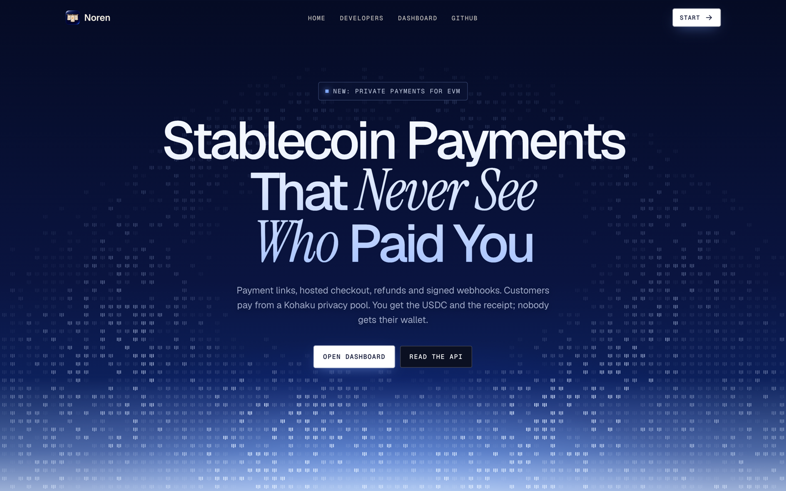
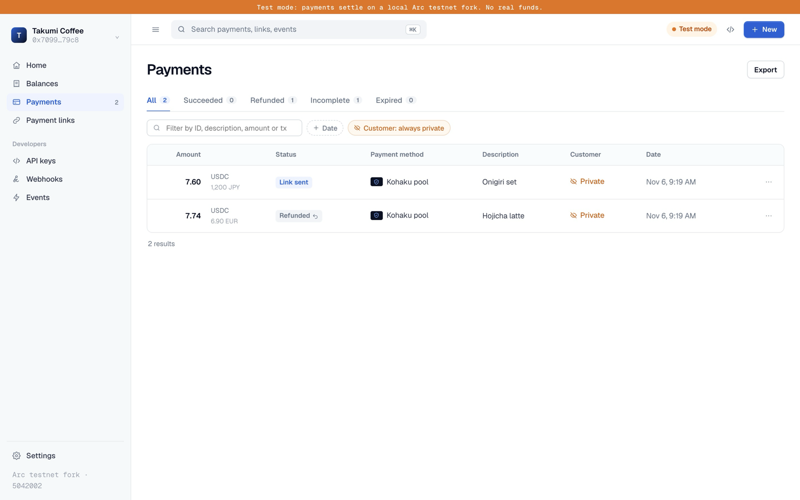
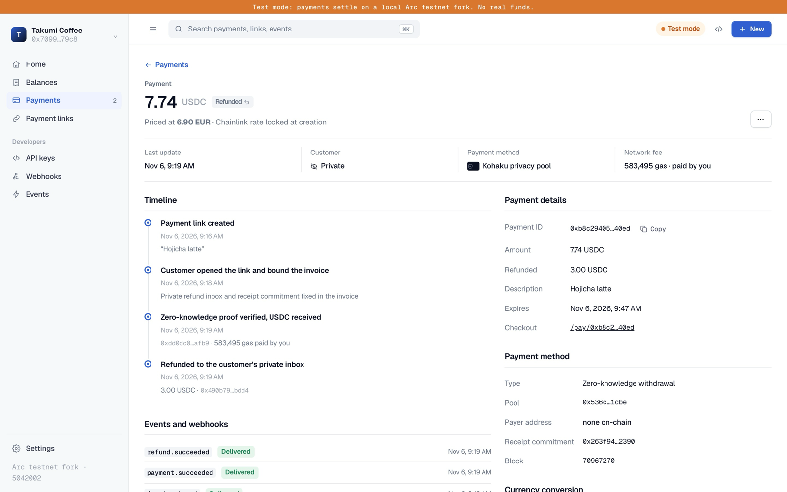
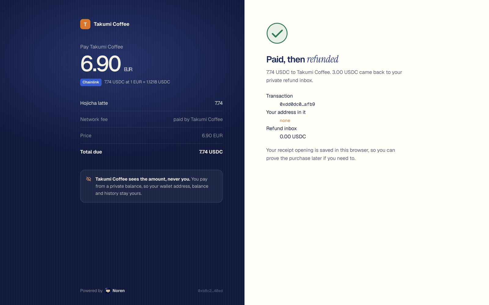

# Noren (暖簾)

**Private payments for EVM.** Payment links, hosted checkout, refunds, signed webhooks and a TypeScript SDK, like the card-payments stack merchants already know, except the customer pays from a [Kohaku](https://github.com/ethereum/kohaku) privacy pool. The merchant gets the USDC and a receipt. Nobody, the merchant included, gets the customer's wallet.



| | A plain USDC transfer | A Noren payment |
|---|---|---|
| Merchant learns the payer's address | yes, forever | **no** |
| Merchant (and everyone) sees the payer's balance and history | yes | **no** |
| Paid in full, on time, for this invoice | trust the sender | **enforced by a ZK proof** |
| Funds screened for compliance | no | **yes** (ASP checks USDC's blacklist) |
| Refunds | back to the public wallet | **into a private inbox only the customer can see** |
| Who pays gas | the customer | **the merchant (~$0.01 on Arc)** |

## What a merchant gets
- **Dashboard** (`#/dashboard`), built like a card-payments dashboard:
  - **Home:** today vs yesterday, the on-chain USDC balance, and period-over-period cards (gross, net, payments, refunds, links, average). Customers identified: 0.
  - **Balances:** the balance read live from the payout address, plus a payment/refund ledger with CSV export.
  - **Payments:** status tabs, search, date filter, CSV export and row menus. Each payment has its own page with a timeline, gas, webhooks, a refund dialog, and the Chainlink rounds behind its quote.
  - **Payment links:** a builder with live checkout preview and fiat pricing, plus copy link and QR.
  - **Developers:** API keys, webhook endpoints with delivery stats, and a split-view event log.
  - **Everywhere:** ⌘K search, the "+ New" menu and toasts.
- **Hosted checkout** (`#/pay/:invoiceId`): merchant name, line item, countdown, private balance, the proof made on the customer's device, and a receipt.
- **REST API + webhooks**: see [docs/API.md](docs/API.md). Events `invoice.created`, `invoice.bound`, `payment.succeeded` and `refund.succeeded` are HMAC-SHA256 signed (`noren-signature: t=…,v1=…`), retried 3 times, and every delivery is logged.
- **SDK**: `@noren/core/merchant` (`createNoren`, `invoices.create/list/retrieve/refund`, `profile.set`, `webhooks.create/list/del`, `verifyWebhook`) and `@noren/core/customer` (`shield`, `refundInbox`, `proveInvoicePayment`).

```ts
import { createNoren, verifyWebhook } from "@noren/core/merchant";
const noren = createNoren({ server, token: process.env.NOREN_SECRET_KEY, merchant });
const { invoice } = await noren.invoices.create({ amount: 7_500_000n, description: "Flat white", expiresIn: 1800 });
// later, in your webhook handler:
const event = await verifyWebhook(rawBody, req.headers["noren-signature"], secret); // payment.succeeded → fulfil
```

**Priced in any currency, with Chainlink.** Price a link in EUR, GBP, JPY, CAD, AUD, MXN, BRL or KRW. Noren reads Chainlink Data Feeds (fiat/USD and USDC/USD), checks decimals, positivity and staleness, rounds up, and locks the USDC quote until the link expires. Both round IDs are stored on the invoice, so anyone can re-check the quote with `getRoundData`. Chainlink feeds are live on **Arc mainnet** but not on Arc testnet, so prices are read from Arc mainnet (read-only `eth_call`, no transactions), while settlement stays on Arc testnet. `NorenQuoter.sol` is the on-chain consumer, tested in a fork of Arc mainnet against the real feeds. Measured Nov 6: €6.90 → 7.740672 USDC (EUR/USD round 18446744073709551777); ¥1,200 → 7.600519 USDC. Details are in [docs/CHAINLINK.md](docs/CHAINLINK.md).

**Why "for EVM":** the contracts are plain Solidity on 0xbow's Privacy Pools, and the SDK is viem. Nothing is Arc-specific except the chain config and the USDC address, so it ports to any EVM chain with Circle USDC. The first (and only tested) network is Arc testnet, run as a local fork; the public deployment waits on testnet USDC.

## How it works
- **Invoice-bound proofs.** The customer's Privacy Pools withdrawal proof binds the invoice, the merchant, the amount and the refund address. Change any field and the pool rejects it (`ContextMismatch`).
- **The merchant relays.** The merchant's server submits the payment and pays the gas, so the customer needs no gas, no public wallet and no relayer company. Only the merchant can relay its own invoices, which closes invoice squatting.
- **Private refunds.** The merchant refunds into the customer's shielded refund inbox, fixed when they paid. The customer's Kohaku wallet discovers it; the merchant never learns who they refunded.
- **Selective receipts.** A receipt commitment the customer can later open for warranty or tax.

Built on the Ethereum Foundation's [Kohaku](https://github.com/ethereum/kohaku) SDK and 0xbow's [Privacy Pools](https://github.com/0xbow-io/privacy-pools-core) (Apache-2.0, see NOTICE). Proofs are made on the customer's device.

## Status
Feasibility spike **passed** on a local fork of Arc testnet (chain 5042002): see [SPIKE.md](SPIKE.md). Phase 2 adds a merchant HTTP server, ASP postman, customer TypeScript library, deployment script, and a full local-fork e2e runner. The latest measured results are in [TESTING.md](TESTING.md). No Arc testnet deployment has been made.

```sh
pnpm install --store-dir './.pnpm-store'
pnpm spike     # anvil fork of Arc testnet → deploy Privacy Pools + NorenCheckout → shield → invoice-bound proof → pay → refund → forge tests
pnpm e2e       # fresh fork → merchant HTTP server + ASP postman + customer library → all attacks + refund approval
pnpm dev:stack # one local fork + deploy + demo merchant server + fast ASP; Ctrl-C stops it
pnpm test      # Vitest core and server validation
pnpm exec tsc --noEmit
```

## Phase 2 packages

- `@noren/core`: Arc/fork chain config, deployment reader (`@noren/core/node`), ABI-accurate invoice encoding, and customer helpers (`@noren/core/customer`). Amounts are USDC base units: `7_500_000n` is 7.50 USDC. Invoice JSON uses decimal strings for big integers.
- `@noren/server`: small Node HTTP server, JSON state in ignored `data/`, merchant-key relay, bearer-gated refund, and SSE on `GET /events` (`invoice_created`, `paid`, `refunded`).
- `@noren/postman`: scans real pool `Deposited` logs, checks the Arc USDC `isBlacklisted(depositor)` view before approving labels, and batches `Entrypoint.updateRoot`. It serves versioned LeanIMT tree snapshots at `/asp/tree?v=N`; the root event's CID field contains the exact snapshot URL. The URL must be 32–64 bytes long per Entrypoint.

The merchant first registers a payout with `NorenCheckout.registerMerchant(payout)`. The merchant console creates a **draft** with `POST /merchants/:address/invoices` and `{ "amount": "7500000", "expiry": "<Unix seconds>" }`. The response has the invoice ID and checkout address for the payment link. The customer obtains a refund precommitment from `refundInbox()` and a receipt opening from `createReceipt()`, then calls `POST /invoices/:id/bind` with `{ "refundPrecommitment": "<decimal field element>", "receiptCommitment": "0x<32 bytes>" }`. Binding succeeds once and makes the invoice immutable. The bind response has the complete invoice and encoded payment data. The customer calls `rememberReceipt(invoice, opening)`, then sends the output of `proveInvoicePayment(invoice)` as JSON to `POST /invoices/:id/pay`. Payment requires an exact match to the bound invoice. `GET /invoices/:id` and `GET /merchants/:address/invoices` are public; the latter lists newest first with status and transaction hashes. `POST /invoices/:id/refund` takes `{ "amount": "2500000" }` and `Authorization: Bearer <NOREN_REFUND_TOKEN>`.

`pnpm dev:stack` starts an Anvil fork at `http://127.0.0.1:8645` (chain 5042002), installs the fork-only USDC shim, deploys the real verifiers, Entrypoint proxy, pool, and checkout, and registers Anvil account 1 as merchant with its own payout. It writes ignored `deployments/31337-fork.json`; this filename marks the local fork, while the JSON `chainId` remains 5042002. The live server at `http://127.0.0.1:8790` exposes `GET /config` and `POST /dev/faucet` (50 shim USDC plus native gas once per address), accepts CORS from `http://localhost:5190` and `http://127.0.0.1:5190`, and requires the printed merchant bearer token for invoice creation and refund. Reads and customer binding/payment are public. The ASP at `http://127.0.0.1:8788` batches roots about every 5 seconds. Dev endpoints refuse a non-loopback RPC or a node that is not an Anvil fork of chain 5042002. Only the fork is written to; stop the command with Ctrl-C. Browser bundling notes are in [packages/core/BROWSER.md](packages/core/BROWSER.md).

For local services, set `NOREN_RPC_URL`, `NOREN_MERCHANT_KEY`, `NOREN_POSTMAN_KEY`, and `NOREN_REFUND_TOKEN` in the environment, then run `pnpm --filter @noren/server start` and `pnpm --filter @noren/postman start`. Neither key is logged. The e2e runner uses Anvil's unlocked merchant account on loopback and never imports a private key. Production services need their own durable secret storage and publicly reachable ASP tree URL.

`scripts/deploy-arc.ts` deploys the verifiers, Entrypoint proxy, USDC complex pool and checkout, registers the pool, and writes ignored `deployments/5042002.json`. It checks the deployer's native and ERC-20 USDC balance before any transaction on a remote RPC and prints only the address when funding is needed. It was **not run against Arc testnet**. Set `NOREN_POSTMAN_ADDRESS` to give a separate postman key the Entrypoint role; it defaults to the deployer. To invoke later: `NOREN_DEPLOYER_KEY=... NOREN_RPC_URL=https://rpc.testnet.arc.io pnpm exec tsx scripts/deploy-arc.ts`.

The pinned prover artifacts come from the 0xbow `privacy-pools-core` commit `7bc392dad5fa483f53cf74e25d7ad19f0fc6d85f/packages/circuits`, the same URL used by `@fatsolutions/privacy-pools-core-circuits@1.0.5`. `withdraw.zkey` is about 17.8 MB and is **not in Git**. `artifactProverFactory` fetches it once per process and caches it in ignored `cache/zk/` on Node or Cache Storage (`noren-zk-v1`) in a browser. Pass `artifactBaseUrl` to `createCustomer` for a mirror URL or a local filesystem directory in Node; pass durable `storage` to retain receipt openings across app restarts. Browser proving remains to be measured on a phone.

MIT © 2026 Nivesh Gajengi (Noren code). Vendored Privacy Pools contracts keep their Apache-2.0 headers.

## The app (dashboard + hosted checkout)









Run it locally against an Arc testnet fork:

```sh
pnpm install --store-dir './.pnpm-store'
pnpm dev:stack                      # fork + contracts + merchant server (8790) + ASP (8788); prints a merchant token
pnpm --filter @noren/web dev        # http://localhost:5190
```

Measured in a real browser on the local fork, Nov 6 2026 (three runs): 20 USDC shielded and approved by the ASP in ~6 s; a 7.50 USDC invoice paid privately with the **proof generated in the browser in 1.06–4.77 s** (warm vs first proof after page load; 1.6–5.9 s click-to-paid); the merchant console showed it as paid with **customer: unknown**; a 2.50 refund landed in the customer's private refund inbox. The customer's wallet is a test-network key and seed kept in the browser; proofs never leave the device.

### Assets
The app icon and the isometric illustrations were generated with ChatGPT; the curtain film on the landing page was generated with Google Gemini (Veo) and keeps Gemini's visible mark. Product screenshots on the landing page are real captures of this app on the local Arc fork. Fonts: Geist, Geist Mono, Instrument Serif (Google Fonts, OFL).
