# Noren (暖簾)

> **Noren is a DEX and stablecoin payment infrastructure on Arc (liquidity, credit lines and cross-chain settlement), and every payment is private: a merchant never learns which customer paid.**

- **1inch Aqua** is the engine that turns anything into the merchant's USDC: stock payments, liquidations and cross-chain fills.
- **Circle CCTP V2 + Chainlink CCIP** bring money and orders from other chains to Arc.
- **Chainlink CRE** orchestrates the chains and checks every price against Chainlink Data Feeds.
- **World ID + 0G** grant credit safely to real humans; **Earn/Borrow** is where the credit comes from.
- **Kohaku privacy pools** are why the merchant never sees the payer. Swaps and bridges are public; the payment is what's private.

ETHGlobal Mumbai. One product with three surfaces: **Noren Merchant** (`#/dashboard`), the **Noren app** (`#/app`) and the **Noren SDK** (`@noren/core`, `@noren/cctp`, `@noren/ccip`, `@noren/xchain-aqua`).

## Try it in 30 seconds

No install: open any link in the table below; every one is a real public-testnet transaction. Locally:

```sh
pnpm install && pnpm dev:all          # Arc fork + Robinhood snapshot + contracts + CRE simulator + servers
pnpm --filter @noren/web dev          # http://localhost:5190
```

Then: **Noren Merchant** `#/dashboard` → create a link → pay it at `#/pay/<id>` with **Pay privately** (proof made in your browser, ~1.1 s). **Noren app** `#/app/bridge` → *Bring USDC to Arc* from any of 10 CCTP testnets (public testnets, your test key needs faucet USDC). `#/app/swap` → *Cross-chain* sells NVDA on Robinhood for USDC on Arc through an Aqua maker (fork demo).

## What's private

| | How | Live on Arc testnet |
|---|---|---|
| **Pay a Noren invoice** | Groth16 proof bound to the invoice, made in the browser; the merchant relays it from the Kohaku pool | [`0x1ce6858a…`](https://explorer.testnet.arc.io/tx/0x1ce6858a82a86d309d41f4639d9c958a3d50a82804ed6b2efc7d82435780776a), and paid from a cross-chain arrival [`0xc833c436…`](https://explorer.testnet.arc.io/tx/0xc833c436734b1b0425d5cab6fa6aefc0b7ecbc83a2deeb2c46d2cc14ad6589ff) |
| **Send privately** | P2P withdrawal relayed by Noren (`Entrypoint.relay`); the recipient never sees the sender | [`0x69dc6a2d…`](https://explorer.testnet.arc.io/tx/0x69dc6a2ddc6c6e6cdb0a53813a46cca3d74c9d0d6ead85c8050709519c94ce09) |
| **Arrive private** | CCTP burn with a SHIELD hook: the USDC lands straight in the pool (`NorenShieldSink`) | Arbitrum burn [`0xe55d5240…`](https://sepolia.arbiscan.io/tx/0xe55d52400e1fb3c7d3d5e73184c7eff64bf8947c0d8e07716ca9c447f63fe593) → pool [`0xdf7b3d45…`](https://explorer.testnet.arc.io/tx/0xdf7b3d45b4363e9e66ed866e1c7356d294a894ef074554e36d6cb1f15548815c) |
| **Not private** | Swaps, bridges, deposits, amounts; the testnet pool's crowd is small | [docs/PRIVACY.md](docs/PRIVACY.md) |

## Live on public testnets

| What | Transactions |
|---|---|
| Arc testnet deploy: `NorenCheckout`, Privacy Pools Entrypoint and USDC pool, `NorenRateOracle`, `NorenCreditLine` | [`NorenCheckout`](https://explorer.testnet.arc.io/address/0xe18a80506fdb7f5498aad7387a21134118a77547) · all addresses in [docs/LIVE.md](docs/LIVE.md) |
| **Private payment**, 2.50 USDC: no payer address in the tx | [`0x1ce6858a…`](https://explorer.testnet.arc.io/tx/0x1ce6858a82a86d309d41f4639d9c958a3d50a82804ed6b2efc7d82435780776a) |
| **Private refund**, 1.00 USDC into the customer's shielded inbox | [`0x890ab6a6…`](https://explorer.testnet.arc.io/tx/0x890ab6a618a3caf187eb26a3071660ef2f2f2d8de9298b8c71658f66c2ee016a) |
| **CRE writes**: FX rates → `NorenRateOracle`; a credit line → `NorenCreditLine` | [`0xa7f67bcc…`](https://explorer.testnet.arc.io/tx/0xa7f67bcc1b1a7095c1b9ffb9c20a357abea78ddbaa4b1a255b65854633321b64) · [`0x2b066d78…`](https://explorer.testnet.arc.io/tx/0x2b066d786b83c7fbe9d51035fbf543667139c74304e414aa6a91d50fe0f9f42e) |
| **CCTP Base Sepolia → Arc, invoice paid on arrival** (PAY_INVOICE hook → `NorenArcActionRouter`, `InvoicePaid`; relayed by CRE) | burn [`0x69189700…`](https://sepolia.basescan.org/tx/0x691897008418bf06e0fbff5ae7c23be09663f84d2a976cec94a5f183184b6160) → Arc [`0x5f752147…`](https://explorer.testnet.arc.io/tx/0x5f752147fb96908488a120d4fb840093d8411244d2f4140f20af13c99875cc84) |
| **CCTP Arbitrum Sepolia → Arc**: plain, and an Aqua order opened on arrival | [`0xf4cf3e42…`](https://sepolia.arbiscan.io/tx/0xf4cf3e42f57a4097b406c587fe6f19a7e85e1d73f02937bb76f5d15d0847b53c) → [`0xb72b97ea…`](https://explorer.testnet.arc.io/tx/0xb72b97ea2d1a6d6aabbf532a947e7bfa1acf4b4d18c4bd6127929742e4bdbee6) · [`0xb7ff5e88…`](https://sepolia.arbiscan.io/tx/0xb7ff5e888260730ac16c2583cb2b16c56403de5234b5b761c3cc3069f2fd2949) → [`0xd46f2427…`](https://explorer.testnet.arc.io/tx/0xd46f2427adbd3970e8119ba2090f1cb2e293768949ec32526ad8c90f2c6feb60) |
| **CCTP Robinhood ↔ Arc** | Robinhood → Arc [`0xc5c221b0…`](https://explorer.testnet.chain.robinhood.com/tx/0xc5c221b026281d1832e92a108184ee535914a349eb2795de27d16a6ffca346f8) → [`0x7828cd32…`](https://explorer.testnet.arc.io/tx/0x7828cd32598c10a81046bfcaf9cfc36baef7d327387b2fd8b34396565e836ac7) · Arc → Robinhood [`0x433c334a…`](https://explorer.testnet.arc.io/tx/0x433c334a242ccf2203eb4e1cdc3cc795c606cf3b7877647b0fc1bf6eb193f7fe) → [`0xc74ce4d1…`](https://explorer.testnet.chain.robinhood.com/tx/0xc74ce4d19f01cb573df7d3c3af0e30d06ef043d6a0832cf87b6380755d1a56b5) |
| **1inch Aqua on Arc**: official Aqua v1.0.0 (unmodified) at [`0x550C…895B`](https://explorer.testnet.arc.io/address/0x550CD499f1E2da71527f14d6469364461966895B), a Chainlink-pegged USDC→EURC maker; CCTP burns from Arbitrum and Ethereum Sepolia with an AQUA_ORDER hook, filled on Arc by CRE | swap [`0xc7dfd911…`](https://explorer.testnet.arc.io/tx/0xc7dfd9119afe91a1f77cb253d1ae9f75420ccd65e61fcba55dbe10ac21d96cd8) · Arbitrum fill [`0xe6dab620…`](https://explorer.testnet.arc.io/tx/0xe6dab62029db1e6924cb6ff6e229248e7bbb29d6863c2157fdb0a9dd01568dd7) · Ethereum fill [`0x243cc90e…`](https://explorer.testnet.arc.io/tx/0x243cc90eed57c6273fc790d91e73ec5af25bd29a0c3d38c20c0bbd26f955dd93) ([docs/AQUA-LIVE.md](docs/AQUA-LIVE.md)) · partial Dutch-auction liquidations; borrower kept 0.355 NVDA vs 0.002 under full liquidation (fork demo, [docs/AQUA.md](docs/AQUA.md)) |
| **CCIP into Arc**: 7 messages, all delivered (message IDs on ccip.chain.link) | Base Sepolia → Arc, CREDIT_LINE [`0xc54e5cf9…`](https://ccip.chain.link/msg/0xc54e5cf92c21ef23e7784dd1148e48a91b75eb9a0ff2bc52ab6d4de80664d504) · Ethereum Sepolia → Arc, PAY_ON_CREDIT [`0x3414a5d3…`](https://ccip.chain.link/msg/0x3414a5d397f5c4222aa8a30bc75c085b53127533b62376dc132923b6ec2df1a4) (merchant paid on Arc [`0x78d3a38f…`](https://explorer.testnet.arc.io/tx/0x78d3a38fd41c1c2b9bee066a94ad2c83837203cd5b00b9e0bd001155edc7d7ec)) · Robinhood → Base hub → Arc: [`0x8bf11c20…`](https://ccip.chain.link/msg/0x8bf11c2010e50817e88d2c61a896dbcffde95af5352cda9b0c342f073bac477d), [`0x5b04344b…`](https://ccip.chain.link/msg/0x5b04344b6baea78121553f912df5dc3e959e320df7712ca4d82a5763559df93d) · Arc → hub → Robinhood line report [`0x56603748…`](https://ccip.chain.link/msg/0x56603748215991241c874b9dc17bc44e0dce534ed0f0fb7746e79922b4541009) |

Arc Studio app: https://studio.arc.io/app/074b59c4-98ec-44d4-908e-92f5d97d462b. Full records: [docs/LIVE.md](docs/LIVE.md), [docs/PRIVACY.md](docs/PRIVACY.md), [docs/CCTP.md](docs/CCTP.md), [docs/CCIP.md](docs/CCIP.md), [docs/AQUA-LIVE.md](docs/AQUA-LIVE.md).

## What's simulated

- **Robinhood side on a fork.** Stock payments, Aqua makers, Uniswap v4, Earn, Borrow and `NorenCredit` run on a local snapshot of Robinhood Chain mainnet (real Stock Tokens and Chainlink feeds; Robinhood testnet has neither). The hosted checkout and fiat invoices run on a local Arc testnet fork; the live private payment above was made from the SDK and the merchant server.
- **Aqua: live on Arc, forks for stocks.** Aqua can't be deployed at its canonical address on Arc testnet (1inch's CREATE3 factory has no code there), so the unmodified v1.0.0 runs at its own address; the SwapVM router is ours (official SwapVM plus the `NorenOraclePeg` opcode). The stock makers and the NVDA cross-chain route run on Robinhood mainnet forks.
- **CCIP carries instructions, CCTP carries value.** No CCIP lane carries USDC (or CCIP-BnM) into Arc, so CCIP messages into Arc are instructions paid from Noren's Arc liquidity; dollars arrive over CCTP.
- **Live prices go stale between CRE runs.** `NorenRateOracle` refuses quotes once its Chainlink round is older than 25 h; the app shows "price stale" until `scripts/live/cre-live.ts` runs again.
- **CRE in the simulator.** Every CRE run is `cre workflow simulate --broadcast` through Chainlink's `MockKeystoneForwarder` (which doesn't check DON signatures), not a deployed DON. The public-testnet writes above are real transactions made that way.
- **CCIP is slow on testnets.** Robinhood → Arc goes through a Base Sepolia hub and took ~38 min (two finality waits); Base → Arc ~20 min.
- **Privacy gaps.** SHIELD over CCIP isn't live (no CCIP lane carries USDC into Arc). The ASP postman still checks only the on-chain depositor; for a cross-chain arrival, the source-sender screen ran in the live script, not in the postman.
- **Unaudited.** Every Noren contract is hackathon code.

## Architecture

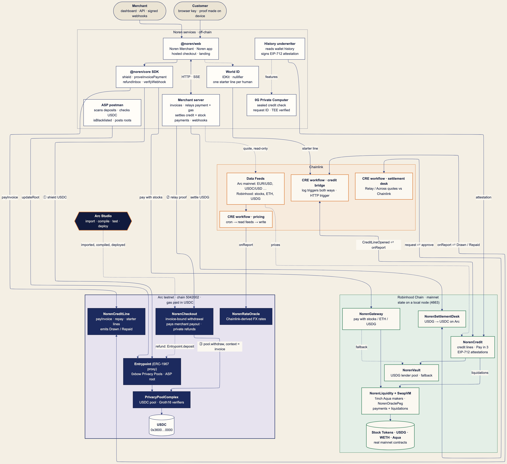

Every rail into Arc lands in one `NorenArcActionRouter` (`0x3D2d…A7A4` on Arc testnet): CCTP through `NorenArcHook`, CCIP through `NorenCcipGateway`. Rails: [docs/CCTP.md](docs/CCTP.md), [docs/CCIP.md](docs/CCIP.md), [docs/XCHAIN.md](docs/XCHAIN.md). Details and flows: [docs/ARCHITECTURE.md](docs/ARCHITECTURE.md). Credit line: [docs/CREDIT.md](docs/CREDIT.md), [docs/BRIDGE.md](docs/BRIDGE.md). Pricing: [docs/CHAINLINK.md](docs/CHAINLINK.md), [docs/CRE-PRICING.md](docs/CRE-PRICING.md). AI credit check: [docs/0G.md](docs/0G.md). World ID: [docs/WORLD.md](docs/WORLD.md). Arc: [docs/ARC.md](docs/ARC.md). API: [docs/API.md](docs/API.md).

---

Everything below is detail.

## One product, three surfaces

| Surface | Route | What it does |
|---|---|---|
| **Noren Merchant** | `#/dashboard` | Payments with the method used (private pool, pay with stocks, pay later), payment links priced in 9 currencies by Chainlink, refunds, balances, webhooks, API keys, credit-line exposure, and **Settle to Arc** for USDG earned from stock payments. "Customers identified: 0" for private payments. |
| **Noren app** | `#/app` | The customer's side: private balance, Stock Tokens at live Chainlink prices, a credit score from on-chain history (and a sealed AI second opinion on 0G), lock stock for a credit line, watch Chainlink CRE bridge it to Arc, repay. No stock? Verify with World ID for a small starter line. |
| **Noren SDK** | `@noren/core` | `createNoren` (invoices, refunds, webhooks, `verifyWebhook`) for merchants; `shield`, `refundInbox`, `proveInvoicePayment` for customers. The hosted checkout `#/pay/:id` is the drop-in. |

```ts
import { createNoren, verifyWebhook } from "@noren/core/merchant";
const noren = createNoren({ server, token: process.env.NOREN_SECRET_KEY, merchant });
const { invoice } = await noren.invoices.create({ amount: 7_500_000n, description: "Flat white", expiresIn: 1800 });
// send the customer to /pay/{invoice.invoiceId}; later, in your webhook handler:
const event = await verifyWebhook(rawBody, req.headers["noren-signature"], secret); // payment.succeeded → fulfil
```

## Ways to pay one invoice

| | Pay privately | Pay with stocks | Pay later |
|---|---|---|---|
| Customer pays with | USDC in a Kohaku privacy pool (Arc) | NVDA, TSLA, AAPL… Stock Tokens (Robinhood Chain) | A USDC credit line on Arc, backed by locked Stock Tokens |
| Merchant receives | USDC on Arc, in the payment tx | USDG on Robinhood Chain, from a 1inch Aqua maker (or Noren's vault as fallback) | USDC on Arc, upfront, from the credit pool |
| Merchant learns the payer | **no**: the proof binds the invoice, not a wallet | yes (public wallet) | yes (the line is public) |
| Contract | `NorenCheckout` + 0xbow Privacy Pools | `NorenGateway` → `NorenLiquidity` (1inch Aqua + SwapVM), `NorenVault` fallback | `NorenCredit` (Robinhood) ↔ CRE ↔ `NorenCreditLine` (Arc) |
| Price | Chainlink fiat feeds (Arc mainnet, read-only) | Chainlink stock feeds (Robinhood): makers quote through the `NorenOraclePeg` SwapVM instruction; the vault adds a 0.50% spread | Chainlink stock feeds value the collateral |

The checkout says it plainly: only "Pay privately" (the default) hides you. **Pay from another chain** (Circle CCTP V2 with a PAY_INVOICE hook, from 10 testnets) is a fifth option; it is public on the source chain.

Pay with stocks: Powered by SwapVM — © Degensoft Ltd 2025 (see [Third-party licenses](#third-party-licenses)).

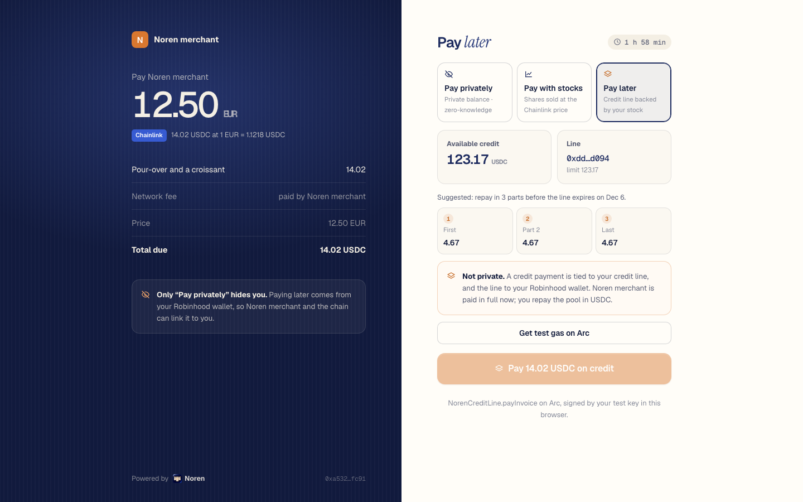

## Measured (local forks, Nov 6 2026)

| What | Result |
|---|---|
| All suites on the final build ([TESTING.md](TESTING.md)) | **574 passed**, 1 skipped (weekend-only), 0 failed; `pnpm test` alone **136 passed**, 20 files |
| `pnpm e2e`: private payment on an Arc testnet fork, real 0xbow pool and Groth16 verifier | **9/9** Foundry checkout tests, **5/5** attacks reverted on-chain (`IncorrectASPRoot`, `ContextMismatch`, `NotMerchant`, `Expired`, `AlreadyPaid`), proof 1.28 s, re-proof 1.14 s, 39.0 s total |
| Private payment in headless Chromium against `pnpm dev:all` | shield approved by the ASP in **6.1 s**, proof made in the browser in **1.13 s**, click to paid **6.0 s**, payer address in the tx: **none** |
| `pnpm e2e:credit`: pay with stocks + pay later, end to end | **8/8** steps in **24.5 s**: fork faucet → EIP-712 attestation verified on-chain → 2 NVDA locked → **CRE Robinhood → Arc in 6.0 s** → invoice paid later and settled by the server → 0.040798 NVDA at $184.61 pays a 7.50 invoice, filled by a 1inch Aqua maker (fee 0.0377 USDG; merchant gets 7.50 USDG) → CRE carries `Drawn` and `Repaid` back to Robinhood |
| One CRE simulator run (bridge workflow, `--broadcast` through the MockKeystoneForwarder) | 4.6–5.2 s per event |
| Settle to Arc: CRE settlement-desk workflow on a 7.50 USDG request | live quotes Relay 7.475568 / Across 7.491332 USDC against a Chainlink fair value of 7.501225; approved Across with a 7.426212 minimum in 6.4–7.1 s |
| CRE pricing workflow → `NorenRateOracle` on Arc | written in 5.0 s; a €6.90 invoice (7.740672 USDC) passes `verifyQuote` at its own Chainlink rounds |
| Browser, Noren app | fresh wallet, fork faucet, tier-1 terms (score 13/100, collateral-only floor), 1 NVDA locked → 123.80 USDC line, live on Arc after one CRE run (4.8 s), a ¥1,200 checkout (7.60 USDC via Chainlink) paid later, 1.90 USDC repaid |
| Package suites | `NorenCredit`/`NorenGateway`/`NorenLiquidity`/`NorenVault` **112** Foundry tests on a fresh Robinhood mainnet fork (Aqua routing, Pay in 3, SwapVM liquidations); `NorenOraclePeg` + Aqua router **18**; `NorenCreditLine` **47**; `NorenRateOracle` **22**; CRE bridge **31** + pricing **8** (bun); World ID **43** and the 0G underwriter **25** run inside `pnpm test` |

Fork transaction hashes vanish when the fork stops, so the numbers above are reproducible with the commands below rather than linked.

## Screens

| Noren Merchant | Noren app |
|---|---|
| 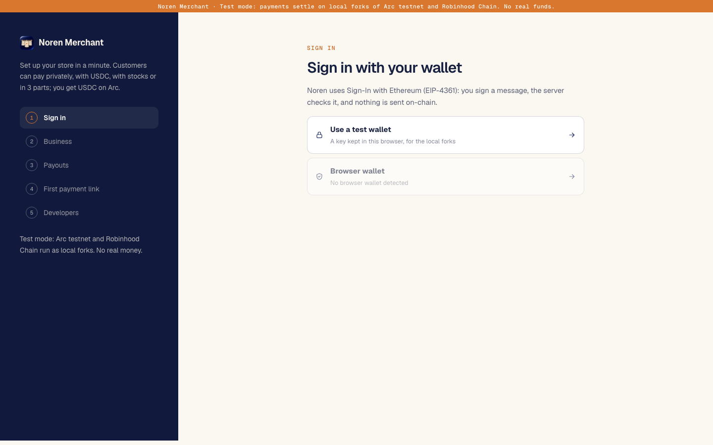 | 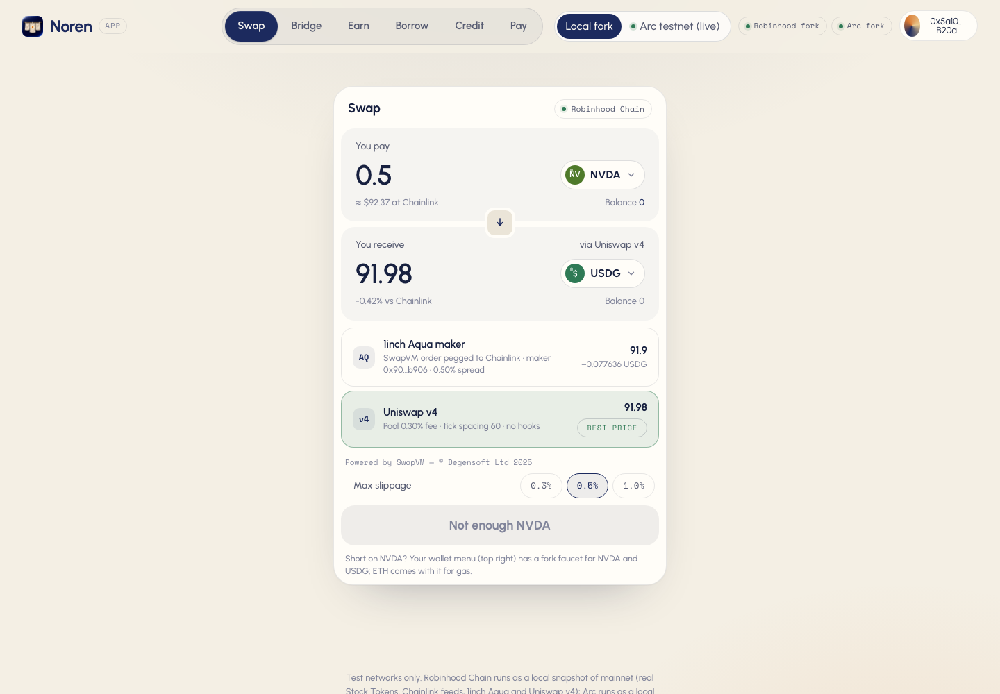 |
| 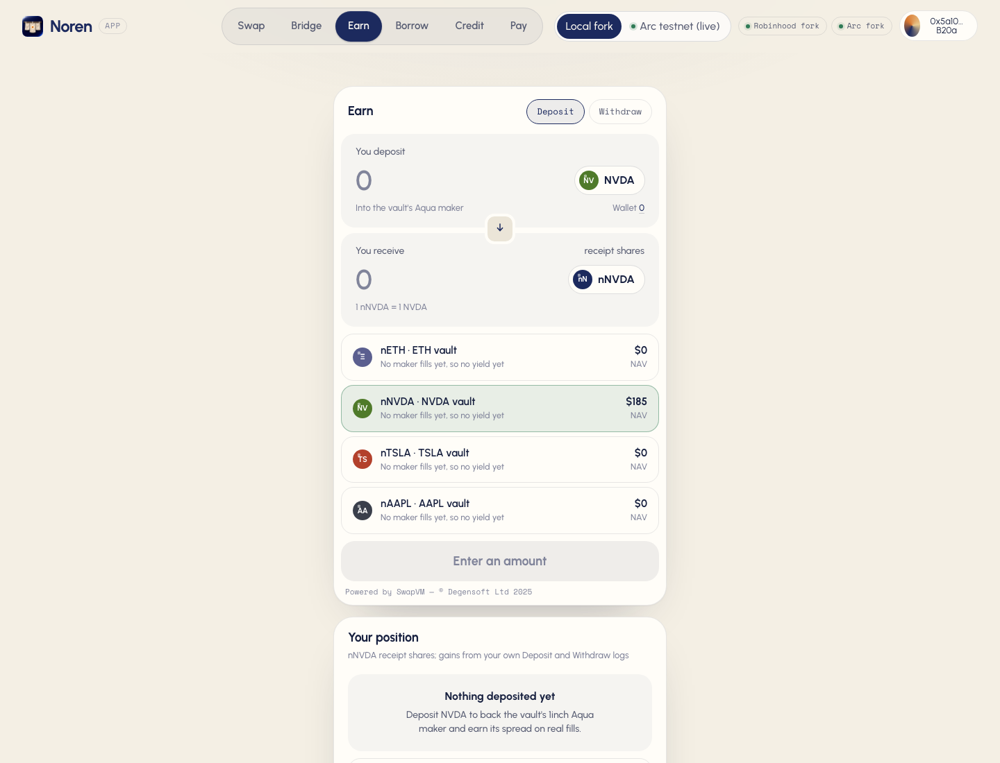 | 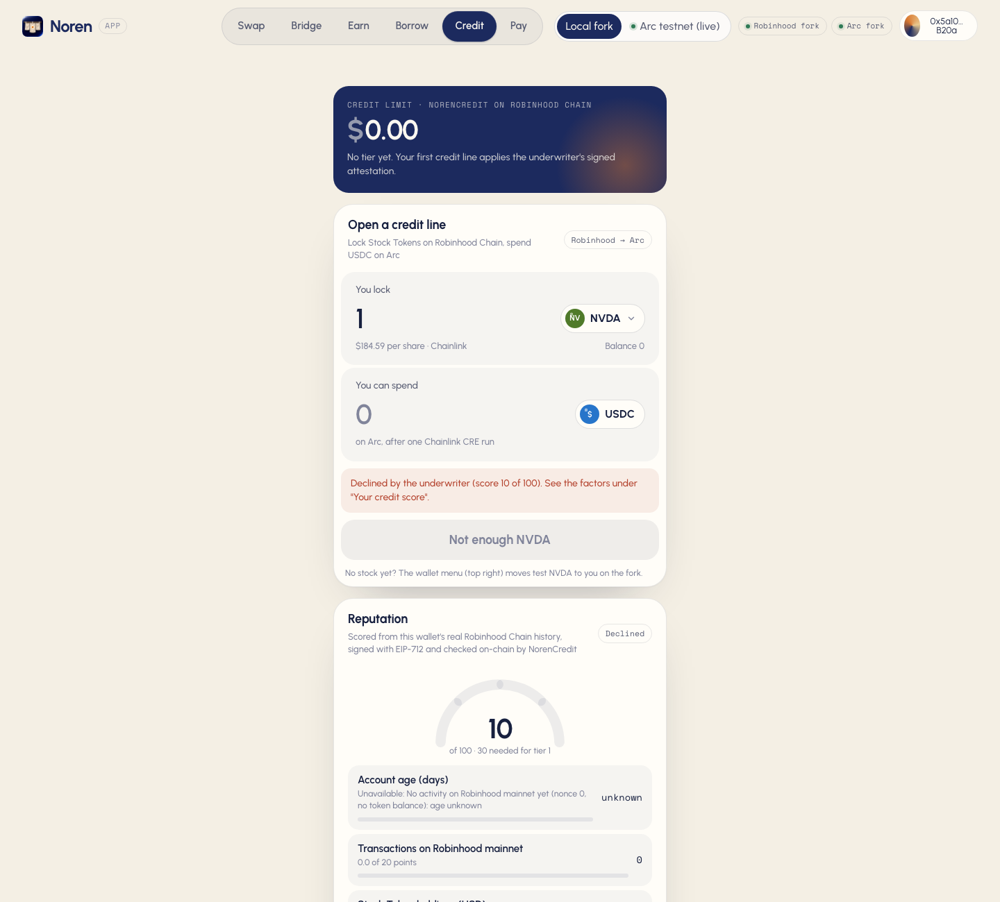 |
| 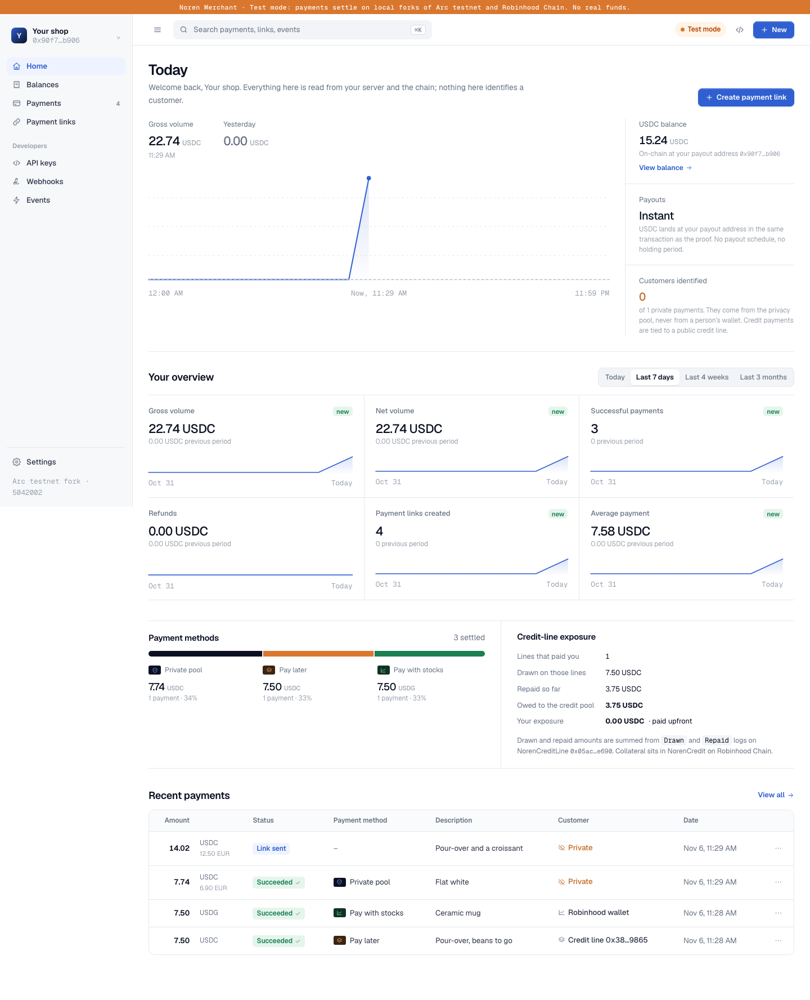 | 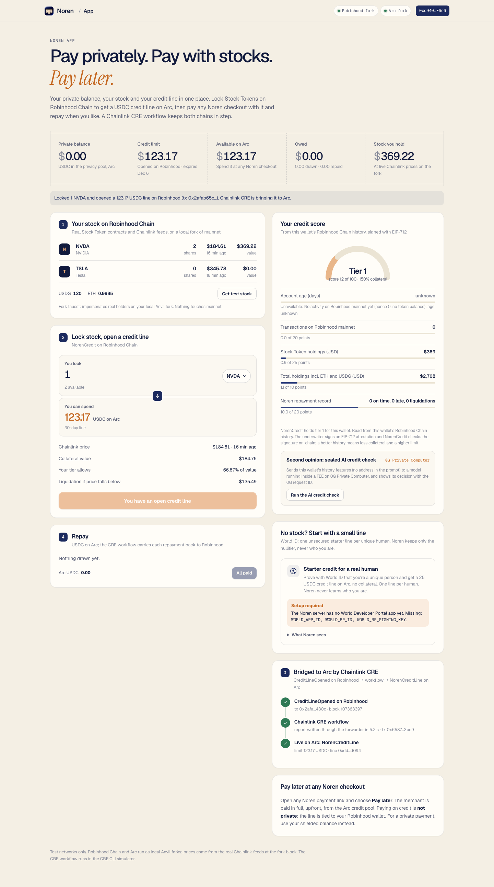 |
| 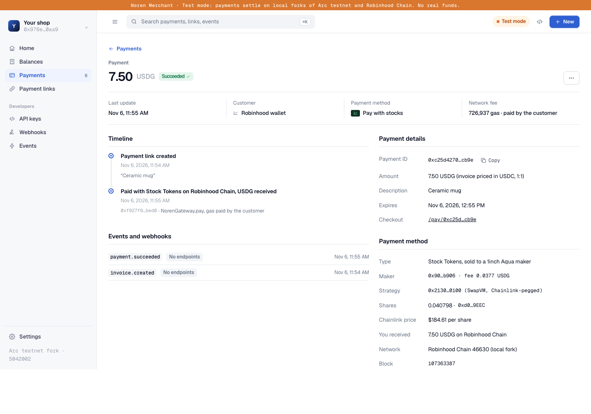 | 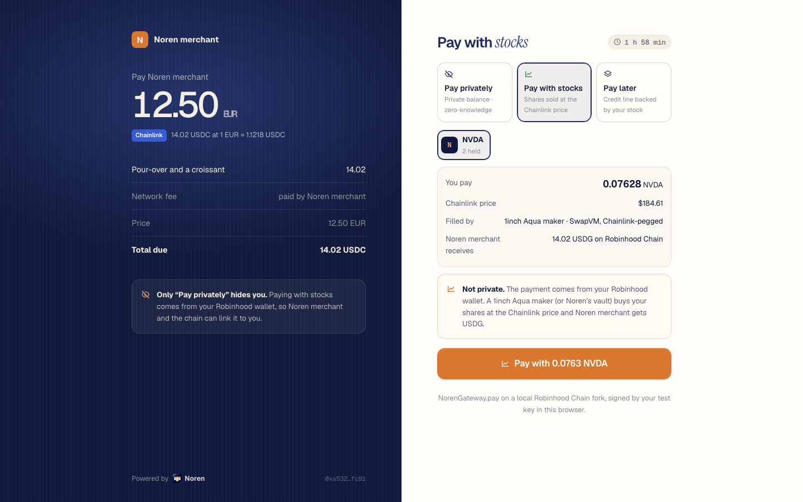 |
| 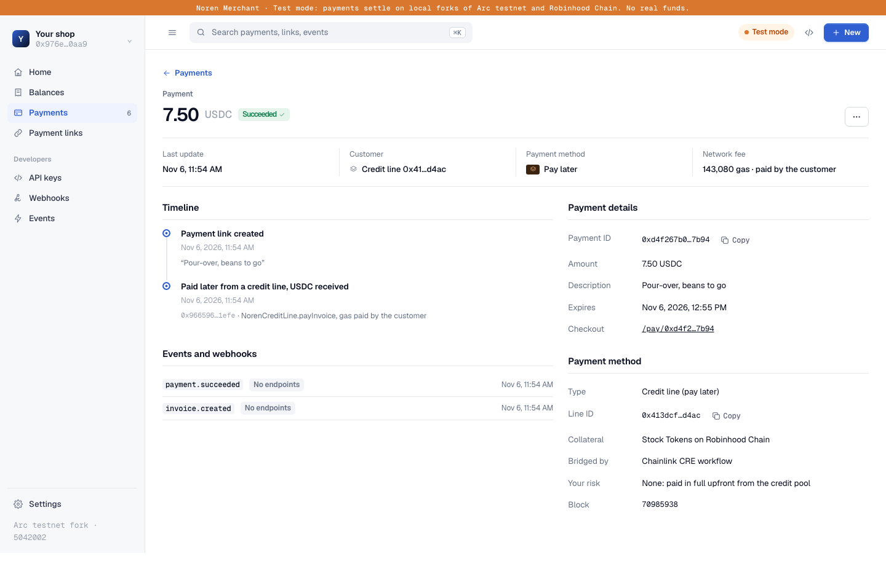 |  |
| 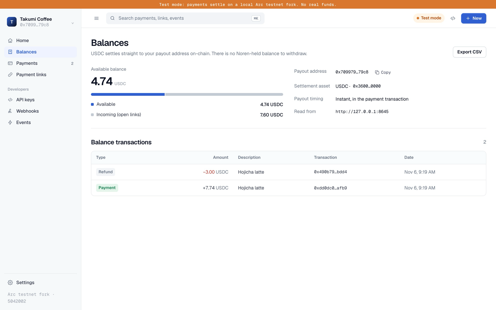 | 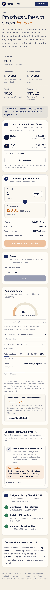 |

## Run it

```sh
pnpm install
pnpm dev:all                    # Arc fork + Robinhood snapshot + contracts + server + ASP + both CRE workflows + underwriters
pnpm --filter @noren/web dev    # http://localhost:5190  (#/dashboard, #/app, #/pay/:id)
```

`pnpm dev:all` prints the merchant secret key for Noren Merchant and a "Setup required" line for anything it can't start. In one process it runs:

- **Arc testnet fork** on :8645 with the real Privacy Pools verifiers, Entrypoint, pool, `NorenCheckout`, `NorenRateOracle` and `NorenCreditLine`. A fork-only USDC shim stands in for Arc's native USDC, which stock Anvil can't execute.
- **Robinhood Chain** on :8646, from the Robinhood package's warmed snapshot of mainnet state: the real Stock Tokens, USDG and Chainlink feeds, with `NorenCredit`, `NorenGateway` and `NorenVault` deployed. The public RPC keeps only about 10 minutes of state, so a live fork breaks; build the snapshot once with `sh packages/robinhood/scripts/fork-snapshot.sh`. The node is served as chain 46630 (Robinhood testnet's id) because that is the only Robinhood chain the CRE simulator knows, and Robinhood testnet's real `MockKeystoneForwarder` is installed on it.
- **Cross-chain Aqua** (fork): the official Aqua and SwapVM router bytecode from Arc mainnet on the Arc fork, `NorenCrossChainSettler` with an Aqua maker on Arc, `NorenCrossChainEscrow` for NVDA on Robinhood, and its CRE workflow relaying each order and fill (`GET /xchain/orders`). Skip with `NOREN_SKIP_XCHAIN=1`.
- **CRE**: the pricing workflow runs once at start (live Arc mainnet Chainlink reads, then a write to `NorenRateOracle`). The credit bridge workflow runs in the CRE simulator for every `CreditLineOpened`/`CreditLineClosed` on Robinhood and every `Drawn`/`Repaid` on Arc, with `--broadcast` through the forwarders. The run log is at `GET /credit/bridge`.
- **Merchant server** (:8790), **ASP postman** (:8788), **history underwriter** (:8791), **0G credit check** (:8792), **World ID** routes on the merchant server.

Other commands:

```sh
pnpm dev:stack       # the private-payments stack only (Arc fork)
pnpm test            # offline tests
pnpm e2e             # private payment + attacks + refund on a fresh Arc fork
pnpm e2e:credit      # pay with stocks + pay later against a running dev:all (NOREN_MERCHANT_TOKEN=<printed key>)
pnpm deploy:arc:dry  # measures the Arc testnet deploy on a fork from the real deployer; writes deployments/5042002-dryrun.json
pnpm deploy:arc      # the real Arc testnet deploy (needs NOREN_DEPLOYER_KEY and testnet USDC)
pnpm studio:import   # sends the Arc contracts to Arc Studio (needs arc-studio login)
```

Local runs write `deployments/5042002-fork.json` (e2e) and `deployments/31337-fork.json` (dev stack), never `5042002.json`.

## How a private payment works

- **Invoice-bound proofs.** The customer's Privacy Pools withdrawal proof binds the invoice, merchant, amount and refund address. Change any field and the pool rejects it (`ContextMismatch`).
- **The merchant relays.** The merchant's server submits the proof and pays about a cent of gas, so the customer needs no gas and no public wallet. Only the merchant can relay its own invoices.
- **Compliance.** The ASP postman approves a deposit only if Arc USDC's own `isBlacklisted(depositor)` is false.
- **Private refunds** go into a shielded refund inbox fixed when the customer paid. **Selective receipts** let the customer prove the purchase later, if they choose.
- **Any currency.** Links priced in EUR, GBP, JPY, CAD, AUD, MXN, BRL or KRW are quoted from Chainlink Data Feeds on Arc mainnet (read-only) and locked until expiry. Both round IDs are stored, and `NorenRateOracle` on Arc re-checks the quote at those rounds ("Rate verified on-chain").

## How pay later works

1. **Score.** The history underwriter reads the wallet's real Robinhood Chain history (account age, transaction count, Stock Token holdings at Chainlink prices, past Noren repayments) and scores it. A sealed model on **0G Private Computer** gives a second decision with a 0G request ID and TEE verification. Any wallet that locks Stock Tokens gets at least the collateral-only tier (150%); history only improves terms.
2. **Attest.** The underwriter signs an EIP-712 `CreditAttestation`; `NorenCredit.applyAttestation` verifies it on-chain.
3. **Lock.** `NorenCredit.openCreditLine` values the shares with Chainlink (with a weekend haircut when markets are closed) and emits `CreditLineOpened`.
4. **Bridge.** The Chainlink CRE workflow writes the limit to `NorenCreditLine` on Arc through the forwarder.
5. **Spend.** On any Noren checkout, "Pay later" calls `NorenCreditLine.payInvoice`; the merchant is paid USDC upfront and the server settles the invoice from the `Drawn` log.
6. **Repay.** USDC on Arc, in parts or at once; the app suggests `NorenCredit.INSTALLMENTS()` parts (3). CRE carries each `Drawn`/`Repaid` back to `NorenCredit`. Debt left after expiry plus grace, or collateral below 110% of the debt, makes the line liquidatable, and liquidation sells the collateral to 1inch Aqua makers through SwapVM.
7. **No stock?** Verify with World ID (IDKit, server-verified) for one small unsecured starter line per human. Noren stores only the nullifier.

## CROPS

- **Censorship resistant.** The customer's funds sit in a Privacy Pools contract, not with Noren: they can withdraw or pay any merchant without Noren's permission. Settlement is a contract call any merchant server can relay; the merchant runs its own.
- **Open source.** MIT (Noren) and Apache-2.0 (vendored Privacy Pools). One command builds and runs everything locally: `pnpm install && pnpm dev:all`.
- **Private.** What each party learns: the **merchant** learns that an invoice was paid in full, never the payer's address, balance or history. The **Noren server** never sees note secrets, keys or proof inputs; it relays a finished proof. The **ASP** sees only deposit addresses, which it checks against USDC's blacklist. **World ID** gives Noren a nullifier, not a person. The **0G** credit check gets numeric features without an address, inside a TEE. The web app makes **no third-party requests**: fonts and prover artifacts are served by the app itself. Pay with stocks and pay later are *not* private, and the UI says so.
- **Secure.** Keys, note secrets and Groth16 proofs stay in the customer's browser. Invoice-bound proofs make tampering, replay, squatting, expiry and stale roots fail on-chain (the 5 attack checks above). CRE reports are accepted only from the configured forwarder; credit attestations only with the underwriter's EIP-712 signature.

## Honest limits

- **Mostly local forks.** The Arc contracts, the CCTP rail (`NorenArcHook`) and the CCIP gateways and router are live on public testnets (see [Live on public testnets](#live-on-public-testnets)); the hosted checkout and the whole Robinhood side run on local Anvil nodes. No real money or stock moves.
- **Robinhood testnet has no Chainlink feeds**, so the Robinhood side is a snapshot of mainnet state. CRE only knows Robinhood *testnet*, so that node is served as chain 46630 with testnet's simulation forwarder. CRE workflows run in the CRE CLI simulator, not on a DON.
- **World ID and 0G run for real.** World ID is a production RP (fake proofs get 403), so a real verification needs World App (Selfie Check). The 0G credit check runs on glm-5.3 (TeeML) because 0GM-1.0's only TeeML provider fails its TLS handshake; a decision is accepted only when Noren's independent check verifies the enclave signature, the quote binding and the TeeML provider record. Each live 0G call is paid, so the app shows the stored decision and asks before a new one.
- **Settle to Arc** runs the CRE approval for real, but no relayer fills a local fork, so the USDC fill on Arc stays pending. The Robinhood snapshot carries the Relay Depository's code but not the Across SpokePool, so an Across approval is shown and not deposited; `sh packages/bridge-settlement/scripts/fork-settle.sh` runs both deposits on a live fork.
- **1inch Aqua:** Aqua is the official registry `0x1111113CCf1426A8E30e2bfF5E005d929bF6a90a` on Robinhood Chain. The SwapVM router is the official AquaSwapVMRouter (`0x111111338c5091E8440b67B168bAe16a668AC0De`) recompiled with one added opcode (`NorenOraclePeg`), so it is redeployed on the fork rather than called at the official address. Maker liquidity on the fork is seeded from a real USDG holder. To replay the Aqua flow on its own: `sh packages/aqua/scripts/aqua-demo.sh` (about 2 minutes on a fresh fork); a recorded run is in [`packages/aqua/demo/aqua-demo-transcript.txt`](packages/aqua/demo/aqua-demo-transcript.txt).
- **Markets closed: wider spread.** From Saturday through Monday 06:00 UTC (and on marked holidays) the Chainlink stock feeds pause, so stock makers add 3% (`closedExtraBps` 300) to their spread and the checkout shows "markets closed: wider spread" next to the quote. A Saturday demo pays about 3% more stock for the same invoice.
- **Snapshot freshness.** The Robinhood snapshot freezes the Chainlink answers it was built with, and USDG/USD goes stale 25 h after its last update, after which makers and the vault refuse to quote. Rebuild it on the day of a demo: `sh packages/robinhood/scripts/fork-snapshot.sh`.
- Stock Tokens can't leave Robinhood Chain and their issuer can pause or block them; only stablecoin value crosses, as a credit limit carried by CRE. See [docs/BRIDGE-ROUTES.md](docs/BRIDGE-ROUTES.md).
- The privacy pool on a fresh fork has few depositors, so timing can link a payment to a deposit; the checkout shows the anonymity set.
- Browser proving was measured on a laptop, not yet on a phone. The contracts are unaudited.

## Repository

| Package | What |
|---|---|
| `packages/contracts` | `NorenCheckout`, `NorenQuoter`, `NorenRateOracle`, fork USDC shim; vendored Privacy Pools |
| `packages/core` | the SDK: chain config, invoice encoding, `@noren/core/merchant`, `@noren/core/customer`, Chainlink pricing |
| `packages/server` | merchant API, relay, webhooks, credit and stock settlement watchers, Robinhood fork faucet |
| `packages/postman` | ASP: USDC blacklist check, Merkle roots |
| `packages/web` | landing, Noren Merchant, Noren app, hosted checkout |
| `packages/robinhood` | `NorenCredit` (credit lines, Pay in 3), `NorenGateway`, `NorenLiquidity` (Aqua maker registry and routing), `NorenVault`, `NorenAssetOracle`, history underwriter, SDK |
| `packages/aqua` | `NorenOraclePeg` (a Chainlink-pegged SwapVM instruction) and `NorenAquaSwapVMRouter` (the official AquaSwapVMRouter plus that one opcode), under the SwapVM-1.1 license |
| `packages/arc-credit` | `NorenCreditLine` |
| `packages/bridge-settlement` | `NorenSettlementDesk`, the settlement CRE workflow and keeper (USDG → USDC on Arc via Relay or Across) |
| `packages/cre-bridge`, `packages/cre-pricing` | Chainlink CRE workflows (TypeScript) |
| `packages/cctp` | `NorenArcHook` (CCTP V2 destination caller on Arc), the CRE relay workflow, `@noren/cctp` (`bridgeToArc`, `burnFromArc`) |
| `packages/ccip` | `NorenCcipGateway`, `NorenCcipHub`, `NorenArcActionRouter` (the one router both rails land in), `NorenCcipInbox`, `@noren/ccip` |
| `packages/xchain-aqua` | cross-chain Aqua: `NorenCrossChainEscrow` (source chains), `NorenCrossChainSettler` (Arc), its CRE workflow and `@noren/xchain-aqua` |
| `film` | the demo film's edit, voice-over and recording scripts |
| `packages/ai-underwriter` | credit check on 0G Private Computer |
| `packages/world-id` | IDKit request signing, server verification, nullifier registry, `VerifyHuman` |
| `scripts` | `dev:all`, `dev:stack`, e2e runners, CRE runner, Arc deploy |

## Third-party licenses

| Part | License |
|---|---|
| Noren (everything not listed below) | MIT, Copyright (c) 2026 Nivesh Gajengi. It calls Aqua and SwapVM only through their published ABIs. |
| `packages/aqua/swapvm-ext` (`NorenOraclePeg`, `NorenAquaSwapVMRouter`) | Degensoft SwapVM-1.1 (`LicenseRef-Degensoft-SwapVM-1.1`). Powered by SwapVM — © Degensoft Ltd 2025. A Modified Work: modifications are copyleft and are published under the same license, with dated changes and build steps in its `NOTICE`. Non-commercial hackathon use (§4). Details: [docs/AQUA.md](docs/AQUA.md#license). |
| Vendored Privacy Pools contracts (`packages/contracts/lib/privacy-pools-core`) | Apache-2.0; files keep their headers (see NOTICE). |

No endorsement by 1inch, Degensoft or 0xbow is implied.

### Assets
The app icon and the isometric illustrations were generated with ChatGPT; the vault film on the landing page (`vault.mp4`) was generated with Google Gemini (Veo) and keeps Gemini's visible mark. Screenshots are real captures of this app on the local forks. Fonts: Geist, Geist Mono, Instrument Serif, and Urbanist + Space Mono in the Noren app (all OFL), bundled from Fontsource.
