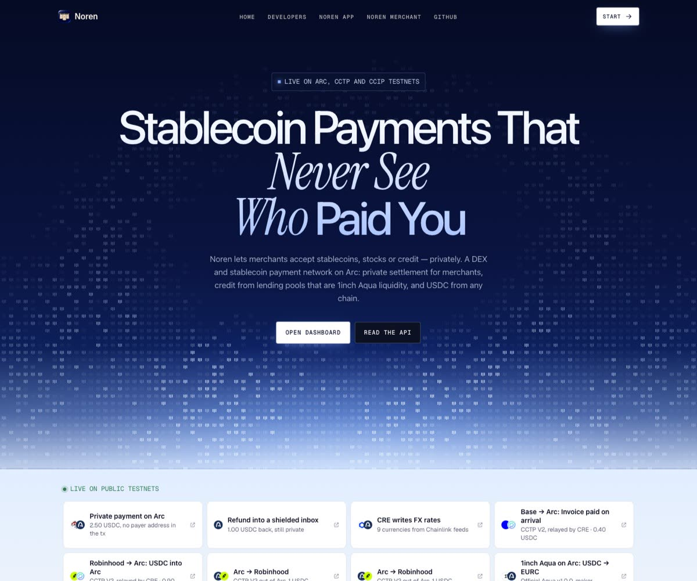
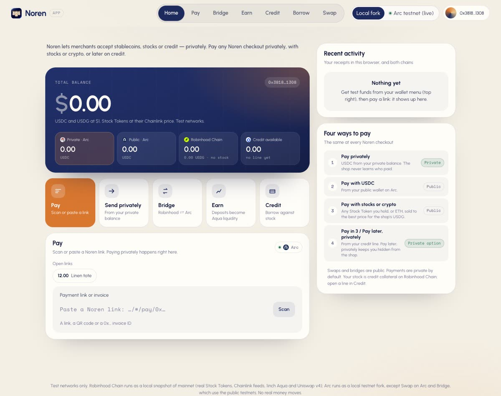
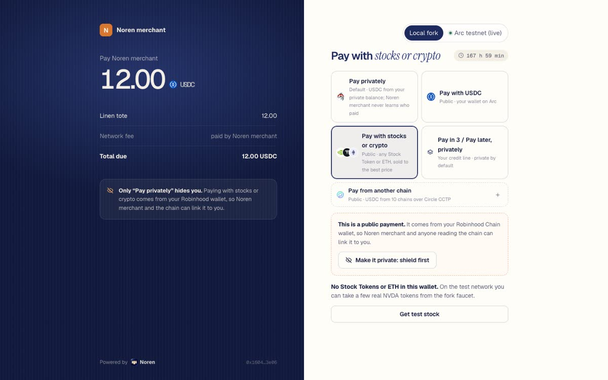
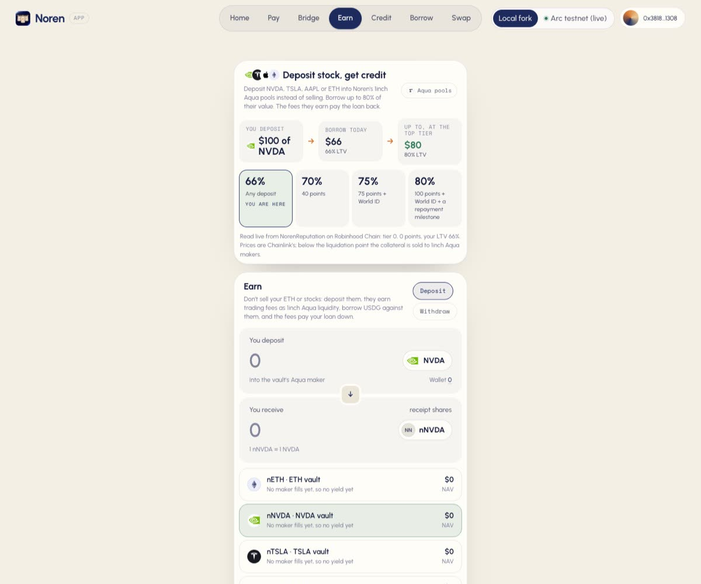
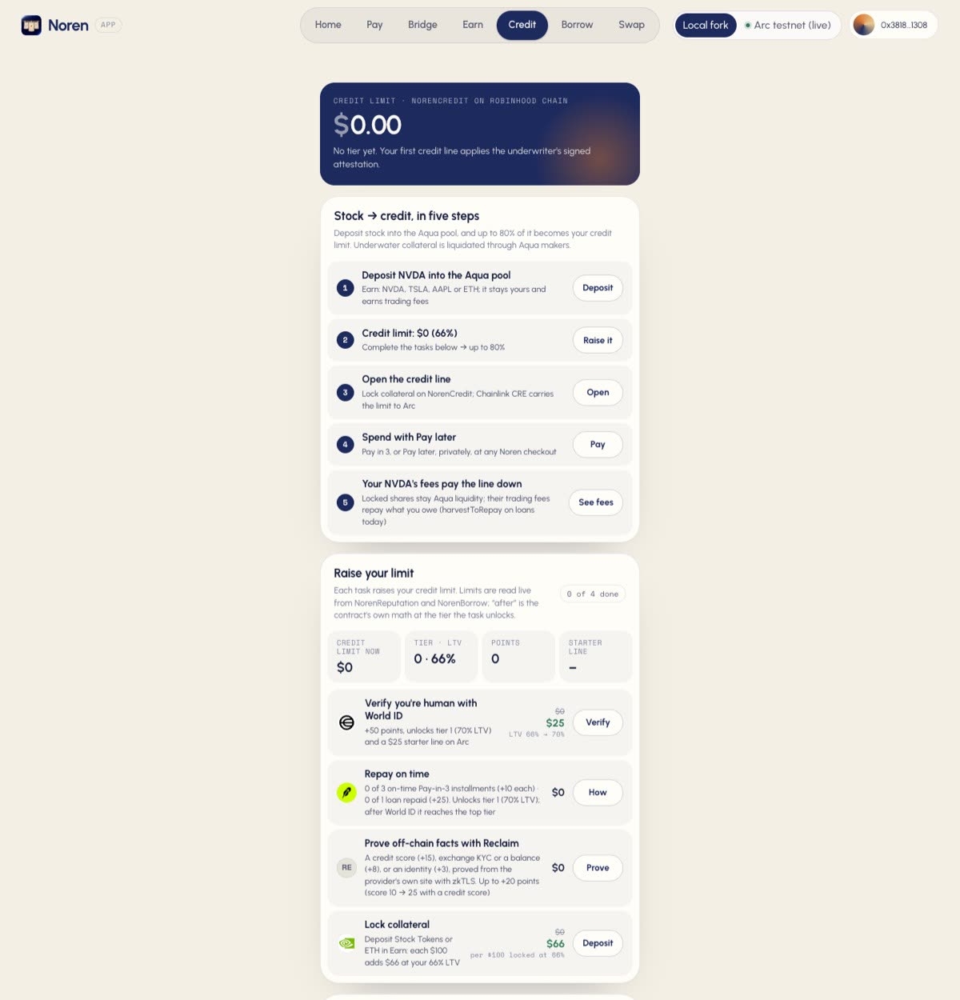
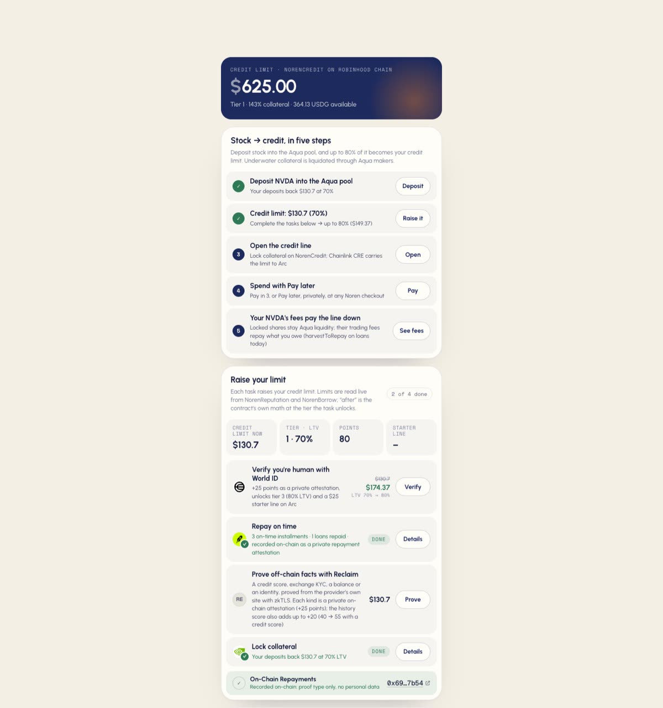
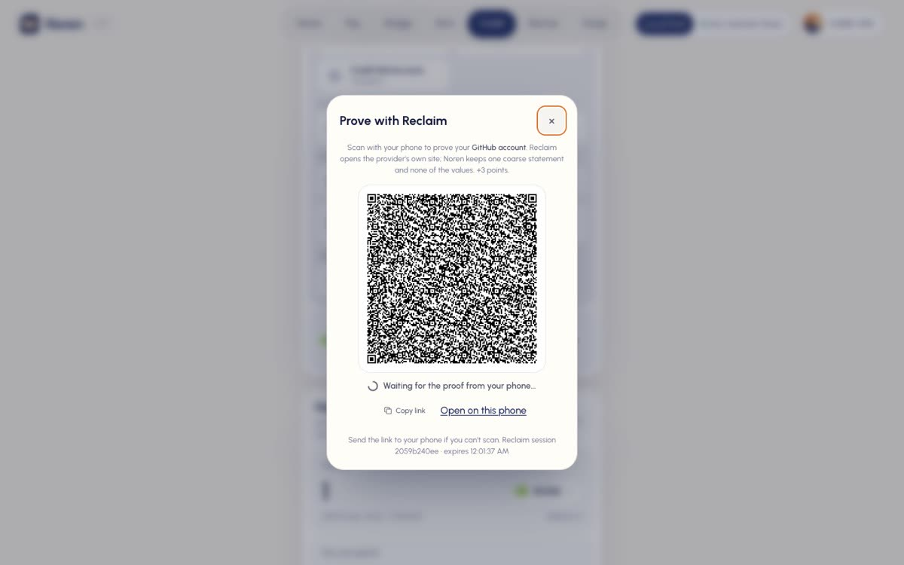
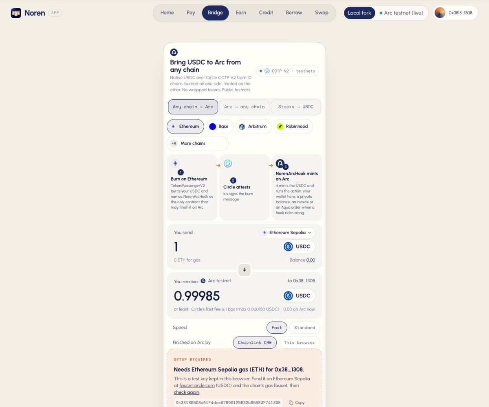
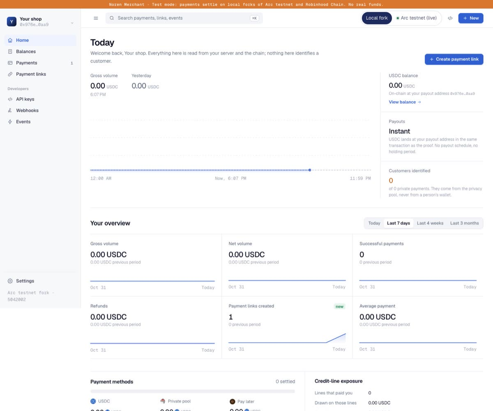

# Noren (暖簾)

> **Pay with your stocks without selling them, privately.**
>
> Noren lets merchants accept **stablecoins, stocks or credit — privately**. Lock NVDA, TSLA, AAPL or ETH in Noren's 1inch Aqua pools, get up to 80% of their value as a credit limit, spend it at any Noren checkout without the shop learning who paid, and let the trading fees your stock earns pay the loan back.



## World is Flat edition

Branch `wif` is a separate, Robinhood Chain-only Noren build for $WIF. A customer pays a USDG invoice with $WIF, ETH, USDG or an eligible Stock Token; the merchant receives USDG. The $WIF path performs an atomic two-hop swap through live Uniswap v4 pools. A 30 bps fee on non-WIF invoice payments accrues in USDG, then a keeper buys and burns $WIF. Paying in $WIF waives that fee. The gateway publishes `totalWifBurned` and `WifBurned` events, which the WIF merchant dashboard and receipt read from chain. The batch burn keeps small invoices from each paying for two extra swaps.

This edition uses chain **4663** only. It has no Arc, CCTP, or privacy flow. The current [runbook](docs/WIF.md) covers the verified pool keys, fork tests, build flag (`NOREN_EDITION=wif`), deployment and exact demo transaction checklist. From the repo root, run `sh packages/robinhood/scripts/test-fork.sh` for the fresh-fork contract suite, `pnpm test` for the existing TypeScript suites, and `NOREN_EDITION=wif pnpm --filter @noren/web build` for the WIF app. The public repo is [nickthelegend/noren](https://github.com/nickthelegend/noren). Mainnet deployment, transaction links and a WIF demo video are pending funding and hosting, tracked in [BLOCKED.md](BLOCKED.md).

## Why the name Noren (暖簾)

A noren is the split fabric curtain hung in the doorway of a traditional Japanese shop or restaurant. It tells passers-by the shop is open and shows its name, yet hides who is inside, while air still flows through. Noren does the same for payments: the merchant is open for business and is paid in full, but the curtain hides who paid. It hides the payer, not the payment: the merchant, the amount and the invoice are still visible on-chain. Value still flows freely: USDC from any chain, stocks and credit all settle on Arc.

## Live demo

| Surface | URL |
|---|---|
| Noren app + landing | https://noren-app-beta.vercel.app (`#/app`) |
| Noren Merchant + hosted checkout | https://noren-merchant.vercel.app (`#/dashboard`, `#/pay/<invoiceId>`) |
| Aubelle, a demo shop that takes Noren | https://noren-shop.vercel.app |

**How it's hosted.** The frontends are static builds on Vercel. The backends (merchant API and relayer, ASP postman, the shop's server, an Arc RPC proxy) run on a VPS ([docs/DEPLOY.md § Hosted](docs/DEPLOY.md#hosted-public-demo-nov-7-2026)). Arc is the **public Arc testnet** (5042002), not a fork. The Robinhood side is a **Robinhood Chain · mainnet snapshot**: an Anvil node loaded with real Robinhood Chain mainnet state (Stock Tokens, USDG, Chainlink feeds, 1inch Aqua), so no real money moves.

**What works hosted:**
- **Private checkout on public Arc testnet.** End-to-end on the hosted stack: a store created in Noren Merchant, a 0.25 USDC link, 1.00 USDC shielded from the checkout, approved by the hosted ASP postman, paid privately: [`0x38b8ce96…b0f5`](https://explorer.testnet.arc.io/tx/0x38b8ce96c9ad3a2957467def0194eeba8e2cf0d2d26f5aae9df7b7b8fa12b0f5) (sent by the store's relayer to `NorenCheckout`; the payer's address is not in it).
- **Bridge** (CCTP between public testnets) and **Swap** (USDC → EURC on Arc testnet, live Uniswap v4 and Aqua quotes) in the Noren app.
- **Pay with stocks or crypto** on the Robinhood Chain · mainnet snapshot. Verified after the Nov 7 re-snapshot: a 5 USDC link from the hosted Noren Merchant paid with 0.02681 NVDA through the 1inch Aqua maker, tx `0x21583ee6d251f6eab5fb4979cc5d3c1c1f228dde64284bdf1c986bfaa17a3e1e` on the snapshot node (not a public explorer chain); the server marked the invoice paid.

**What doesn't, hosted:** **Pay later** and **Pay in 3** need the credit bridge, a Chainlink CRE workflow that runs in the CRE CLI simulator, so they run on the local stack only (`pnpm dev:all`). The hosted checkout says so. Also local-stack only: the **World ID** starter line (the hosted server has no World ID routes), the Robinhood **history underwriter** behind Credit → Reputation, **USDG → Arc** settlement and **Stocks → USDC on Arc** (cross-chain Aqua); the hosted app shows "Setup required" for the last three.

**To try it** you need Arc testnet USDC from the [Circle faucet](https://faucet.circle.com) (Arc Testnet) for the app's test key; the privacy pool's minimum deposit is 1 USDC. There is no hosted Arc faucet.

**Pay with stocks or crypto: 10 assets.** SPY, MSFT, AMZN, GOOGL, META, TSLA, AAPL, NVDA, ETH and USDG. Each stock and ETH payment is filled by its own 1inch Aqua maker at the Chainlink price, and the merchant receives USDG. All ten pay an invoice in [`NorenPayEveryAsset.t.sol`](packages/robinhood/contracts/test/NorenPayEveryAsset.t.sol) on a fresh local fork of Robinhood Chain mainnet (3 tests, passed Nov 7). QQQ and COIN are not listed: Chainlink publishes QQQ/USD and COIN/USD on Robinhood Chain, but Noren has no verified QQQ or COIN Stock Token address, so `NorenAssetOracle` doesn't accept them.

**What's new**
- **Stock → credit, without selling.** Deposit a Stock Token or ETH into a Noren Earn vault: it stays yours and becomes 1inch Aqua liquidity. Its value × your tier's LTV is your credit limit: **66% to start, up to 80%** as your reputation grows ($100 of NVDA → $66 today, up to $80). Lock the vault shares behind a credit line (`NorenCredit.openCreditLine`), spend on Arc with Pay later, and the fees the shares keep earning pay the line down (`harvestLineToRepay`). Underwater lines are liquidated through Aqua makers, selling only what the debt needs.
- **Private settlement.** Every private payment is a Kohaku / 0xbow Privacy Pools proof made in the browser and bound to one invoice; the merchant relays it and the payer's address never appears on-chain. "Pay later, privately" draws the credit line straight into the pool, so the shop is paid without learning who paid. Refunds return to a shielded inbox.
- **Reputation that raises your limit, on-chain but private.** World ID (one human), on-time repayments and Reclaim zkTLS proofs (credit score, exchange KYC, balances) are recorded in `NorenReputation` as a proof *kind* plus a salted commitment, never the data. Your tier, and so your LTV, is computed on-chain.
- **USDC from any chain to Arc.** Circle CCTP V2 from 10 configured testnets, live from the app from Ethereum, Base, Arbitrum and Robinhood; a hook can pay an invoice, open an Aqua order or shield into the pool on arrival. Chainlink CRE orchestrates the relays, FX prices and credit lines; Chainlink CCIP carries credit instructions (10 messages, all delivered).

**Demo video:** [ETHGlobal showcase](https://ethglobal.com/showcase/noren-bh8wb) · **Arc Studio:** [studio.arc.io/app/074b59c4…](https://studio.arc.io/app/074b59c4-98ec-44d4-908e-92f5d97d462b) · **Surfaces:** Noren Merchant (`#/dashboard`), the Noren app (`#/app`), the Noren SDK (`@noren/core`, `@noren/robinhood`, `@noren/cctp`, `@noren/ccip`, `@noren/xchain-aqua`).

## For Arc judges

Everything Arc's judging email asks for, in one place. Each item says plainly what exists.

| Arc asks for | Noren |
|---|---|
| **Live deployment** | Live on **Arc testnet** (public chain 5042002), not Arc mainnet: Noren holds no real funds. Hosted apps: [Noren app](https://noren-app-beta.vercel.app) · [Noren Merchant](https://noren-merchant.vercel.app) · [Aubelle demo shop](https://noren-shop.vercel.app). |
| **Arc Studio project URL** | [studio.arc.io/app/074b59c4-98ec-44d4-908e-92f5d97d462b](https://studio.arc.io/app/074b59c4-98ec-44d4-908e-92f5d97d462b) ("Arc Private USDC Payment"). Studio imported and compiled the 11 Arc contracts, wrote 24 Foundry tests (re-run locally: **24/24 pass**), checked the live deployment read-only and built a console that reads it ([docs/ARC.md](docs/ARC.md#arc-studio), [`arc-studio/`](arc-studio)). **Honest gap:** Noren's code came first; Studio is where the Arc contracts were imported, tested and verified, not where they were first written. |
| **Public repo** | https://github.com/nickthelegend/noren |
| **What it does** | Merchants accept stablecoins, stocks or credit, privately. A customer pays with a zero-knowledge proof made in the browser and bound to one invoice; the shop is paid in USDC on Arc and never learns who paid. |
| **What Arc enables that other chains don't** | USDC is the gas token, so a shopper needs only USDC: no second token to buy before paying. Invoices, refunds and credit lines are all in dollars. Circle CCTP V2 lands USDC from any chain directly in Noren's hook (`NorenArcHook`), which can pay an invoice or shield into the pool on arrival. Fast finality makes a checkout feel like a card payment. |
| **Video walkthrough** | [ETHGlobal showcase](https://ethglobal.com/showcase/noren-bh8wb): the full product on Arc testnet (merchant onboarding, private checkout, bridge from any chain, credit). It doesn't show Arc Studio. |
| **Builder profile** | GitHub [@nickthelegend](https://github.com/nickthelegend) |
| **Contract addresses** | `NorenCheckout` [`0xe18a80506fdb7f5498aad7387a21134118a77547`](https://explorer.testnet.arc.io/address/0xe18a80506fdb7f5498aad7387a21134118a77547) · Privacy Pools Entrypoint [`0xa22f3200ecb4319b48dca49677c2f73cd7260ad5`](https://explorer.testnet.arc.io/address/0xa22f3200ecb4319b48dca49677c2f73cd7260ad5) · USDC pool [`0x393d8d46e1dff8a719820e36d70ba509896ea57d`](https://explorer.testnet.arc.io/address/0x393d8d46e1dff8a719820e36d70ba509896ea57d) · `NorenCreditLine` [`0x4e26d0bfc5ac22b3fe8579afe50cb9584b2a1f86`](https://explorer.testnet.arc.io/address/0x4e26d0bfc5ac22b3fe8579afe50cb9584b2a1f86) · `NorenArcHook` [`0x30C84a5aAD4f4bDd25a27e33F563EfBC2CFaa3F4`](https://explorer.testnet.arc.io/address/0x30C84a5aAD4f4bDd25a27e33F563EfBC2CFaa3F4). The full list is in [Security, verified source, deploy](#security-verified-source-deploy). |
| **One example transaction** | A private payment made on the hosted app: [`0x38b8ce96…b0f5`](https://explorer.testnet.arc.io/tx/0x38b8ce96c9ad3a2957467def0194eeba8e2cf0d2d26f5aae9df7b7b8fa12b0f5). The payer's address is not in the transaction, its input or its logs. More in [Live on public testnets](#live-on-public-testnets). |

## Screenshots

| | |
|---|---|
|  **Noren app**: private and public balances, credit, one-tap pay, bridge, earn |  **Checkout**: pay privately, with stocks or crypto, or later on credit |
|  **Deposit stock, get credit**: the vault is a 1inch Aqua maker; 66% → 80% LTV |  **Raise your limit**: World ID, repay on time, Reclaim, more collateral |
|  **Credit line**: locked nNVDA, recorded on-chain privately, fees pay the line down |  **Reclaim zkTLS**: prove a credit score or KYC from your phone |
|  **Bridge**: USDC from any chain to Arc over CCTP, burn → attest → mint |  **Noren Merchant**: payments settle in USDC; the customer is "Private" |

## Try it

**No install.** Open the [Live demo](#live-demo). Every link under [Live on public testnets](#live-on-public-testnets) is a real transaction on a public testnet.

**Locally.** You need Node 22+, pnpm 10, Foundry (`anvil`, `forge`), bun, and the Chainlink CRE CLI (`cre`). `pnpm dev:all` prints `Setup required: …` for anything missing instead of faking it.

```sh
git clone https://github.com/nickthelegend/noren && cd noren
pnpm install
sh packages/robinhood/scripts/fork-snapshot.sh   # once: warmed snapshot of Robinhood Chain mainnet (real Stock Tokens + Chainlink feeds)
pnpm dev:all                                     # Arc testnet fork + Robinhood snapshot + contracts + CRE simulator + servers
pnpm --filter @noren/web dev                     # http://localhost:5190
```

Then open:
- **The Noren app** (`#/app`). Pick an open link on Home and pay it privately. The proof is made in your browser in about 1 s.
- **Noren Merchant** (`#/dashboard`). Create a link. Its hosted checkout, `#/pay/<id>`, offers four ways to pay.
- **Bridge** (`#/app/bridge`). USDC from any of 10 CCTP testnets to Arc (and back) on the public testnets. This needs testnet USDC and gas on the browser's test key.
- **Credit** (`#/app/credit`). Deposit stock, see your limit at your tier's LTV, raise it with tasks, open a line, pay later, let fees pay it down.
- **Swap** (`#/app/swap`). USDC → EURC on Arc testnet: Uniswap v4 first, Noren's Aqua maker when it quotes better.

```sh
pnpm test                 # 155 unit tests (no fork; one file reads Arc mainnet Chainlink feeds)
pnpm e2e                  # private payment + 5 on-chain attacks + refund on a fresh Arc testnet fork
pnpm e2e:credit           # pay with stocks + pay later, against a running dev:all (NOREN_MERCHANT_TOKEN=<printed key>)
```

## Architecture


Every rail into Arc lands in one `NorenArcActionRouter`: CCTP through `NorenArcHook`, CCIP through `NorenCcipGateway`. The Robinhood Chain side (Stock Tokens, `NorenCredit`, the Aqua makers) talks to Arc only through CRE. Flows and contracts are in [docs/ARCHITECTURE.md](docs/ARCHITECTURE.md), and product detail is in [docs/PRODUCT.md](docs/PRODUCT.md).

## Sponsor integrations

Paths are relative to this repo. Line anchors point at the current `main`.

| Sponsor | What Noren uses | Why it matters | Code | Live proof |
|---|---|---|---|---|
| **1inch Aqua + SwapVM** | Aqua v1.0.0 as the shared-liquidity layer. Two custom SwapVM opcodes: `NorenOraclePeg` (34) quotes from a Chainlink feed and the Stock Token's `uiMultiplier`; `NorenDutchDecay` (35) runs partial liquidation auctions. | One balance backs loans, fills and liquidations without moving. Fees can repay the borrower's loan. | [opcode table](packages/aqua/swapvm-ext/src/routers/NorenAquaSwapVMRouter.sol#L27-L49) · [`NorenOraclePeg`](packages/aqua/swapvm-ext/src/instructions/NorenOraclePeg.sol#L166) · [`NorenDutchDecay`](packages/aqua/swapvm-ext/src/instructions/NorenDutchDecay.sol) · [vault ships its strategy](packages/robinhood/contracts/src/NorenVault.sol#L86) · [Earn vault](packages/robinhood/contracts/src/NorenDepositVault.sol#L123) · [best maker quote](packages/robinhood/contracts/src/NorenLiquidity.sol#L242) · [liquidate](packages/robinhood/contracts/src/NorenLiquidity.sol#L353) · [`harvestToRepay`](packages/robinhood/contracts/src/NorenBorrow.sol#L317) | Aqua on Arc testnet [`0x550C…895B`](https://explorer.testnet.arc.io/address/0x550CD499f1E2da71527f14d6469364461966895B) (runtime identical to 1inch's Arc mainnet Aqua except the metadata hash) · swap [`0xc7dfd911…`](https://explorer.testnet.arc.io/tx/0xc7dfd9119afe91a1f77cb253d1ae9f75420ccd65e61fcba55dbe10ac21d96cd8) · cross-chain fills [`0xe6dab620…`](https://explorer.testnet.arc.io/tx/0xe6dab62029db1e6924cb6ff6e229248e7bbb29d6863c2157fdb0a9dd01568dd7), [`0x243cc90e…`](https://explorer.testnet.arc.io/tx/0x243cc90eed57c6273fc790d91e73ec5af25bd29a0c3d38c20c0bbd26f955dd93) · lending, liquidation and self-repay run on the Robinhood Chain · mainnet snapshot ([docs/AQUA.md](docs/AQUA.md), [docs/EARN.md](docs/EARN.md)) |
| **Chainlink CRE** | Five TypeScript workflows (`@chainlink/cre-sdk` 1.23): **CCTP relay** (log triggers on 10 chains + Circle Iris over HTTP with consensus), **credit bridge** (Robinhood ⇄ Arc log triggers + an HTTP trigger), **pricing** (cron + Arc mainnet feeds over HTTP), **cross-chain Aqua** (log triggers + cron), **settlement desk** (log trigger + live Relay and Across quotes checked against Chainlink feeds) | CRE is the orchestration layer. Every cross-chain credit line, every CCTP arrival and every FX rate on Arc passes through it. | [CCTP relay](packages/cctp/cre/cctp-relay/main.ts#L117-L121) · [credit bridge](packages/cre-bridge/credit-bridge/main.ts#L224-L233) · [pricing](packages/cre-pricing/rate-oracle/main.ts#L159-L161) · [cross-chain Aqua](packages/xchain-aqua/cre/xchain-aqua/main.ts#L169-L183) · [settlement desk](packages/bridge-settlement/cre/settlement-desk/main.ts#L177-L184) · receivers: [`NorenRateOracle.onReport`](packages/contracts/src/NorenRateOracle.sol#L152), [`NorenCreditLine.onReport`](packages/arc-credit/src/NorenCreditLine.sol#L159), [`NorenCredit.onReport`](packages/robinhood/contracts/src/NorenCredit.sol#L653), [`NorenArcHook.onReport`](packages/cctp/src/NorenArcHook.sol#L124) | `cre workflow simulate --broadcast` writes on Arc testnet: FX rates [`0xa7f67bcc…`](https://explorer.testnet.arc.io/tx/0xa7f67bcc1b1a7095c1b9ffb9c20a357abea78ddbaa4b1a255b65854633321b64), credit line [`0x2b066d78…`](https://explorer.testnet.arc.io/tx/0x2b066d786b83c7fbe9d51035fbf543667139c74304e414aa6a91d50fe0f9f42e), CCTP arrival paying an invoice [`0x5f752147…`](https://explorer.testnet.arc.io/tx/0x5f752147fb96908488a120d4fb840093d8411244d2f4140f20af13c99875cc84) |
| **Chainlink CCIP 2.0** | `NorenCcipGateway` on Arc, Base Sepolia, Ethereum Sepolia and Robinhood testnet; `NorenCcipHub` on Base Sepolia (Robinhood has no lane to Arc); replay, out-of-order and failed-message handling (`retryFailed`) | Credit instructions from other chains change state on Arc: a line opens, a merchant gets paid | [`send`](packages/ccip/src/NorenCcipGateway.sol#L177) · [`_ccipReceive`](packages/ccip/src/NorenCcipGateway.sol#L206) · [`retryFailed`](packages/ccip/src/NorenCcipGateway.sol#L284) · [hub](packages/ccip/src/NorenCcipHub.sol#L143) · [router `execute`](packages/ccip/src/NorenArcActionRouter.sol#L178) | 7 runs, 10 messages, all SUCCESS: Base → Arc CREDIT_LINE [`0xc54e5cf9…`](https://ccip.chain.link/msg/0xc54e5cf92c21ef23e7784dd1148e48a91b75eb9a0ff2bc52ab6d4de80664d504) · Ethereum Sepolia → Arc PAY_ON_CREDIT [`0x3414a5d3…`](https://ccip.chain.link/msg/0x3414a5d397f5c4222aa8a30bc75c085b53127533b62376dc132923b6ec2df1a4), merchant paid [`0x78d3a38f…`](https://explorer.testnet.arc.io/tx/0x78d3a38fd41c1c2b9bee066a94ad2c83837203cd5b00b9e0bd001155edc7d7ec) · Robinhood → Base hub → Arc [`0x5b04344b…`](https://ccip.chain.link/msg/0x5b04344b6baea78121553f912df5dc3e959e320df7712ca4d82a5763559df93d) → [`0x5ed8f606…`](https://ccip.chain.link/msg/0x5ed8f6065ca9eabb731bda4214dffe24dbf612d08196732b7c94223784b29984) ([docs/CCIP.md](docs/CCIP.md#live-runs)) |
| **Chainlink Data Feeds** | Arc mainnet fiat feeds (EUR, GBP, JPY, CAD, AUD, MXN, BRL, KRW) price invoices. Robinhood Chain stock, ETH and USDG feeds value collateral and peg the makers. | Invoice quotes are re-verified on-chain at their own round IDs (`verifyQuote`) | [`quoteUsdc`](packages/core/src/pricing.ts#L31) · [`verifyQuote`](packages/contracts/src/NorenRateOracle.sol#L265) · [`NorenAssetOracle`](packages/robinhood/contracts/src/NorenAssetOracle.sol#L147) | `pnpm test` reads live Arc mainnet rounds (`pricing.test.ts`) |
| **Arc (Circle) + CCTP V2** | Arc testnet as the settlement hub (USDC for gas and settlement). `NorenArcHook` is the `destinationCaller` of every Noren burn and hands hook actions (PAY_INVOICE, AQUA_ORDER, SHIELD, CREDIT_LINE) to the router. `@noren/cctp` covers both directions. | Money from 10 configured CCTP testnets lands as USDC on Arc and can act on arrival | [`NorenArcHook.relay`](packages/cctp/src/NorenArcHook.sol#L131) · [`bridgeToArc`](packages/cctp/sdk/bridge.ts#L104) · [`burnFromArc`](packages/cctp/sdk/outbound.ts#L39) · [deployment record](deployments/5042002.json) · [Studio import](arc-studio/) | Base Sepolia burn [`0x69189700…`](https://sepolia.basescan.org/tx/0x691897008418bf06e0fbff5ae7c23be09663f84d2a976cec94a5f183184b6160) → invoice paid on Arc [`0x5f752147…`](https://explorer.testnet.arc.io/tx/0x5f752147fb96908488a120d4fb840093d8411244d2f4140f20af13c99875cc84) · from the app: Arc → Robinhood [`0x03797d2e…`](https://explorer.testnet.arc.io/tx/0x03797d2e9a08af41a78b901d89860dcc30990a9edfc5d91a1e31e02ccbe41307) → [`0xa74ed6e3…`](https://explorer.testnet.chain.robinhood.com/tx/0xa74ed6e3965976538cfd4b37c044f169e80f8549dbec3bfcf149416ad739c954) ([docs/CCTP.md](docs/CCTP.md)) |
| **EF Kohaku + 0xbow Privacy Pools** | `@kohaku-eth/privacy-pools` for shielding and browser proving (snarkjs, self-hosted artifacts). `NorenCheckout` is the pool's processooor and binds the invoice into the withdrawal. | Privacy is structural: the proof, not the UI, keeps the payer off-chain from the merchant | [Kohaku import](packages/core/src/customer.ts#L1-L2) · [plugin](packages/core/src/customer.ts#L72) · [`NorenCheckout.pay`](packages/contracts/src/NorenCheckout.sol#L64-L87) · [5 attack checks](scripts/e2e-fork.ts#L113-L147) | Private payment [`0x1ce6858a…`](https://explorer.testnet.arc.io/tx/0x1ce6858a82a86d309d41f4639d9c958a3d50a82804ed6b2efc7d82435780776a). Its logs name only the pool, `NorenCheckout`, the relaying merchant and the payout; the customer's address is absent. Refund [`0x890ab6a6…`](https://explorer.testnet.arc.io/tx/0x890ab6a618a3caf187eb26a3071660ef2f2f2d8de9298b8c71658f66c2ee016a) |
| **World ID (IDKit 4)** | Server-signed IDKit requests, verified with `developer.world.org` `/api/v4/verify`, plus a nullifier registry: one unsecured starter line per human | Unsecured credit needs Sybil resistance, and Noren stores only the nullifier | [verify](packages/world-id/src/verify.ts#L18) · [registry](packages/world-id/src/registry.ts) | Production RP; one real Orb verification on Nov 6 ([Honest limits](#honest-limits)) |
| **0G Private Computer** | A sealed (TeeML) credit second opinion. The address is never sent, and the enclave signature and TDX quote are checked independently. | The AI underwriter can't see who it scores | [client](packages/ai-underwriter/src/zg.ts) · [independent verify](packages/ai-underwriter/src/verify.ts) | Requests `a30b5e94-…` and `e3fa908f-…` ([docs/0G.md](docs/0G.md)) |
| Uniswap v4 *(used, not entered)* | Default swap route on Arc testnet (V4Quoter + Universal Router) | Swaps go where the liquidity is | [`arc-swap.ts`](packages/web/src/app/arc-swap.ts#L112) | [`0x599879f5…`](https://explorer.testnet.arc.io/tx/0x599879f5950f8eb59494cdd686e8fda57c9b9c0dd6aa697543206df4d9785b31) |
| Reclaim Protocol *(used, not entered)* | zkTLS proofs (credit score, exchange KYC, balances, identity) raise the reputation tier; server-side `verifyProof`, only the proof kind and a salted commitment go on-chain | Credit for people with off-chain history, without exposing it | [server](packages/server/src/reclaim.ts) · [providers](packages/server/src/reclaim-providers.ts) · [docs/RECLAIM.md](docs/RECLAIM.md) | Live request + status URLs with Noren's Reclaim app; a completed proof needs a user's phone |
| Privy *(used, not entered)* | Optional email or wallet sign-in and an embedded wallet for Noren Merchant and the Noren app; the server checks tokens against Privy's JWKS | Customers without a wallet can sign in | [web](packages/web/src/privy.tsx) · [server](packages/server/src/privy.ts#L31) | — |

## Prize requirements

Partner picks: **1inch, Chainlink and Arc**. World IDKit is the alternate.

| Prize | Requirement (prize page) | How Noren meets it |
|---|---|---|
| 1inch: Build an Aqua App | "a sophisticated DeFi position on official Aqua/SwapVM contracts" | Lending pools and Earn vaults are Aqua makers. Collateral earns fill fees, those fees repay loans, and liquidations sell to makers in partial Dutch auctions. On Arc testnet: Aqua v1.0.0, unmodified ([AQUA-LIVE.md](docs/AQUA-LIVE.md)). On the Robinhood Chain · mainnet snapshot: 1inch's official registry `0x1111113C…a90a`. |
| | "custom SwapVM opcodes … scored higher" | Opcodes 34 (`NorenOraclePeg`) and 35 (`NorenDutchDecay`) in a recompiled `AquaSwapVMRouter` (27 tests pass, plus 1 that runs only while markets are closed) |
| | "onchain token transfers in the demo (forks ok)" | Public Arc testnet swaps and cross-chain fills (links above); stock payments on the hosted Robinhood Chain · mainnet snapshot, and stock payments and liquidations in `pnpm e2e:credit` and the Robinhood fork tests |
| | "real git history" | 400+ commits on `main`, the first at Nov 6 03:57 IST (after hacking opened), merged from separate branches per feature |
| Chainlink: Best workflow with CRE | "a CRE Workflow that's used as an orchestration layer" · "integrate at least one blockchain with an external API … data source" · "a successful simulation (via the CRE CLI)" · "meaningfully used" | 5 workflows, all in the product's main paths. External sources: Circle Iris, Relay, Across and Arc mainnet feeds. Simulated with `--broadcast`, with public Arc testnet writes linked above. 76 workflow tests. |
| Chainlink: Best use of CCIP 2.0 | "use Chainlink CCIP … to make a state change on a blockchain" · "CCIP must be used inside your smart contracts" | `NorenCcipGateway` / `NorenCcipHub` are CCIP receivers. Live messages opened a credit line and paid a merchant on Arc (links above). |
| Arc: Best DeFi / Onchain Finance App Built End to End in Arc Studio | "Arc Studio must be the starting point" · "shareable Studio URL" shown in the demo | ⚠️ **Partly met.** The Studio app imports, compiles and tests (24/24) the Arc contracts and verifies the live deployment ([docs/ARC.md](docs/ARC.md#arc-studio)), but the code came before it. The URL still redirects to sign-in. **Nick must make it shareable.** |
| | working frontend + backend, architecture diagram, video, repo | Frontend `packages/web`, backend `packages/server` + `packages/postman`, both live on public Arc testnet and hosted ([Live demo](#live-demo), [docs/LIVE.md](docs/LIVE.md)). Diagram above. Repo public. Video: link added at submission. |
| World: Best Use of IDKit *(alternate)* | "a real trust moment", minimum credential, server or on-chain verification | An unsecured starter line, one per human, with Selfie Check. Server-side `/api/v4/verify` and a nullifier registry (43 tests). One real Orb verification in production, shown in the film. |

## Live on public testnets

On Nov 7 at 03:00 IST, all 135 distinct transaction links in this README, `HACKATHON_SUBMISSION_FORM.md`, `TESTING.md` and `docs/` returned status 1 (`cast receipt`), all 32 linked contract addresses had code (`cast codesize`), and all 10 CCIP message IDs reported SUCCESS on `api.ccip.chain.link`.

| What | Transactions |
|---|---|
| **Arc testnet contracts** | [`NorenCheckout`](https://explorer.testnet.arc.io/address/0xe18a80506fdb7f5498aad7387a21134118a77547) · [Privacy Pools Entrypoint](https://explorer.testnet.arc.io/address/0xa22f3200ecb4319b48dca49677c2f73cd7260ad5) · [USDC pool](https://explorer.testnet.arc.io/address/0x393d8d46e1dff8a719820e36d70ba509896ea57d) · [`NorenRateOracle`](https://explorer.testnet.arc.io/address/0xdb828bdcf33ef0a5a32861e4831ff3dd87be831c) · [`NorenCreditLine`](https://explorer.testnet.arc.io/address/0x4e26d0bfc5ac22b3fe8579afe50cb9584b2a1f86) · [`NorenArcHook`](https://explorer.testnet.arc.io/address/0x8845ae4B87D706c31606182D5A9529b67ee6B20d) · [`NorenArcActionRouter`](https://explorer.testnet.arc.io/address/0x3D2ddF0C08ed3574c25f07E5113CaaB5Db6FA7A4) · [`NorenCcipGateway`](https://explorer.testnet.arc.io/address/0x55005e60b4d4Bed4156BC635B1342bC55d9B6247) · [Aqua](https://explorer.testnet.arc.io/address/0x550CD499f1E2da71527f14d6469364461966895B) · [Noren SwapVM router](https://explorer.testnet.arc.io/address/0x8717687866f988EEBe3bd1d8999DF820ffD9e295) · [`NorenCrossChainSettler`](https://explorer.testnet.arc.io/address/0xd9f90e397770faf66b228344af5fe285b349d016). All of them: [docs/LIVE.md](docs/LIVE.md) |
| **Private payment**, 2.50 USDC, no payer address in the tx | [`0x1ce6858a…`](https://explorer.testnet.arc.io/tx/0x1ce6858a82a86d309d41f4639d9c958a3d50a82804ed6b2efc7d82435780776a) |
| **Private refund**, 1.00 USDC into the customer's shielded inbox | [`0x890ab6a6…`](https://explorer.testnet.arc.io/tx/0x890ab6a618a3caf187eb26a3071660ef2f2f2d8de9298b8c71658f66c2ee016a) |
| **Pay later, privately**: credit drawn into the pool, then a private payment | [`0x25fc8a15…`](https://explorer.testnet.arc.io/tx/0x25fc8a159d88225c5313cd92a3eca3cfaec7c6a3d79b00e19dffc486a81d7bae) → [`0xf3b78257…`](https://explorer.testnet.arc.io/tx/0xf3b782579b4f8076d220085df9d192eaccd0336eb20b974a689993e1fc02723a) |
| **Send privately** (P2P, relayed by `Entrypoint.relay`) | [`0x69dc6a2d…`](https://explorer.testnet.arc.io/tx/0x69dc6a2ddc6c6e6cdb0a53813a46cca3d74c9d0d6ead85c8050709519c94ce09) |
| **CRE writes**: FX rates → `NorenRateOracle`; a credit line → `NorenCreditLine` | [`0xa7f67bcc…`](https://explorer.testnet.arc.io/tx/0xa7f67bcc1b1a7095c1b9ffb9c20a357abea78ddbaa4b1a255b65854633321b64) · [`0x2b066d78…`](https://explorer.testnet.arc.io/tx/0x2b066d786b83c7fbe9d51035fbf543667139c74304e414aa6a91d50fe0f9f42e) |
| **CCTP Base Sepolia → Arc, invoice paid on arrival** (PAY_INVOICE hook, relayed by CRE) | burn [`0x69189700…`](https://sepolia.basescan.org/tx/0x691897008418bf06e0fbff5ae7c23be09663f84d2a976cec94a5f183184b6160) → Arc [`0x5f752147…`](https://explorer.testnet.arc.io/tx/0x5f752147fb96908488a120d4fb840093d8411244d2f4140f20af13c99875cc84) |
| **CCTP Arbitrum Sepolia → Arc**: plain; an Aqua order on arrival; private arrival (SHIELD hook into the pool) | [`0xf4cf3e42…`](https://sepolia.arbiscan.io/tx/0xf4cf3e42f57a4097b406c587fe6f19a7e85e1d73f02937bb76f5d15d0847b53c) → [`0xb72b97ea…`](https://explorer.testnet.arc.io/tx/0xb72b97ea2d1a6d6aabbf532a947e7bfa1acf4b4d18c4bd6127929742e4bdbee6) · [`0xb7ff5e88…`](https://sepolia.arbiscan.io/tx/0xb7ff5e888260730ac16c2583cb2b16c56403de5234b5b761c3cc3069f2fd2949) → [`0xd46f2427…`](https://explorer.testnet.arc.io/tx/0xd46f2427adbd3970e8119ba2090f1cb2e293768949ec32526ad8c90f2c6feb60) · [`0xe55d5240…`](https://sepolia.arbiscan.io/tx/0xe55d52400e1fb3c7d3d5e73184c7eff64bf8947c0d8e07716ca9c447f63fe593) → [`0xdf7b3d45…`](https://explorer.testnet.arc.io/tx/0xdf7b3d45b4363e9e66ed866e1c7356d294a894ef074554e36d6cb1f15548815c) |
| **USDC from any chain, from the Noren app** (Bridge tab, the browser's test key) | Ethereum Sepolia → Arc 0.50 USDC [`0x307a9bcc…`](https://sepolia.etherscan.io/tx/0x307a9bccbf0096967a2efff639afab0fde487933f2783bdd20f557ef0c40f597) → [`0x8a60583d…`](https://explorer.testnet.arc.io/tx/0x8a60583d674d6164344446abdbc74a79114058985507e9136ab1d8c4a423474d) (31 s) · Base Sepolia → Arc [`0x0c032843…`](https://sepolia.basescan.org/tx/0x0c032843dba8cb14c6a8680fa8f143a6ced649b9473ea3e3f92f809b06dad544) → [`0xa45d97f6…`](https://explorer.testnet.arc.io/tx/0xa45d97f634e2954879239bd632c8774054f0a8bdb943753735a4bb757f87a733) (19 s) · Arbitrum Sepolia → Arc [`0xc4b1c12e…`](https://sepolia.arbiscan.io/tx/0xc4b1c12ece1830bfa5dc04938525d141b0d0815ffa3a2e8c5c9a68409b8cfef5) → [`0x34b7f55e…`](https://explorer.testnet.arc.io/tx/0x34b7f55edb7597420b30645e1c8ef402d3b88b821fdc8386be59691ef234d3d5) (16 s) |
| **Robinhood ⇄ Arc from the Noren app** (Bridge tab, the browser's test key) | Arc → Robinhood 0.60 USDC [`0x03797d2e…`](https://explorer.testnet.arc.io/tx/0x03797d2e9a08af41a78b901d89860dcc30990a9edfc5d91a1e31e02ccbe41307) → [`0xa74ed6e3…`](https://explorer.testnet.chain.robinhood.com/tx/0xa74ed6e3965976538cfd4b37c044f169e80f8549dbec3bfcf149416ad739c954) (14 s) · Robinhood → Arc 0.50 USDC [`0x47a2e51a…`](https://explorer.testnet.chain.robinhood.com/tx/0x47a2e51abf964354da8feed31007ae2d3a7218f9a3a962d66e1e88d01b1927c9) → [`0x67711657…`](https://explorer.testnet.arc.io/tx/0x677116575e3ed4d77a8fa026bc51e9290a027b0072b283757414ededb8a2228d) |
| **Swap on Arc testnet from the Noren app** | Uniswap v4 USDC/EURC 0.05% via the Universal Router, 0.05 USDC → 0.041964 EURC [`0x599879f5…`](https://explorer.testnet.arc.io/tx/0x599879f5950f8eb59494cdd686e8fda57c9b9c0dd6aa697543206df4d9785b31) · Aqua maker (better quote), 0.05 USDC → 0.044436 EURC [`0x12df0a9c…`](https://explorer.testnet.arc.io/tx/0x12df0a9cafae3004c5625d83ce641457b7e9facdd8a065890c82503c15654440) |
| **1inch Aqua on Arc**: direct swap; CCTP burns from Arbitrum and Ethereum Sepolia with AQUA_ORDER, filled by CRE | [`0xc7dfd911…`](https://explorer.testnet.arc.io/tx/0xc7dfd9119afe91a1f77cb253d1ae9f75420ccd65e61fcba55dbe10ac21d96cd8) · [`0xe6dab620…`](https://explorer.testnet.arc.io/tx/0xe6dab62029db1e6924cb6ff6e229248e7bbb29d6863c2157fdb0a9dd01568dd7) · [`0x243cc90e…`](https://explorer.testnet.arc.io/tx/0x243cc90eed57c6273fc790d91e73ec5af25bd29a0c3d38c20c0bbd26f955dd93) ([docs/AQUA-LIVE.md](docs/AQUA-LIVE.md)) |
| **CCIP into and out of Arc**: 7 runs, 10 messages, all SUCCESS | [docs/CCIP.md § Live runs](docs/CCIP.md#live-runs) |

## What's private, what isn't

| | Private? | How |
|---|---|---|
| **Pay a Noren invoice** (default) | **Yes**: the merchant never learns the payer | A Groth16 proof made in the browser, bound to the invoice; the merchant relays it from the Kohaku pool |
| **Send privately** | **Yes**: the recipient never learns the sender | A pool withdrawal relayed by Noren (`Entrypoint.relay`) |
| **Pay later, privately** | **From the merchant, yes**. The lender still knows its borrower. | `NorenCreditLine.drawToPool` deposits under the borrower's precommitment, then the invoice is paid from the pool |
| **Arrive private** | Yes on Arc; the source-chain burn is public | A CCTP burn with a SHIELD hook lands in the pool (`NorenShieldSink`) |
| Pay with USDC, pay with stocks or crypto, Pay in 3 | **No**, and the checkout says so | Public wallets |
| Swaps, bridges, deposits, amounts, credit draws and repayments | **No** | Public transactions |

Limits: the testnet pool has few depositors, so timing can link a deposit to a payment (the checkout shows the anonymity set). The ASP screens only the on-chain depositor. Detail: [docs/PRIVACY.md](docs/PRIVACY.md).

**CROPS.** *Censorship resistant:* funds sit in the Privacy Pools contract, not with Noren, and any merchant server can relay. *Open source:* MIT, one-command local build. *Private:* the merchant learns that an invoice was paid in full, never who paid. The Noren server relays a finished proof and never sees note secrets. World ID gives Noren a nullifier, and 0G gets numeric features without an address. *Secure:* keys and proofs stay in the browser. Tampering, replay, outsider relay, expiry and stale roots revert on-chain (5/5 in `pnpm e2e`). CRE reports are accepted only from the configured forwarder. Third parties the web app can call: the chain RPCs and the self-hosted prover artifacts on the private-payment path. Optional features also call Circle Iris (Bridge), World ID (IDKit) and Privy (sign-in, when enabled).

## Security, verified source, deploy

| | |
|---|---|
| Security review | [docs/SECURITY.md](docs/SECURITY.md): every Noren contract reviewed (access control, reentrancy, oracle staleness, rounding, vault inflation, liquidation math, CCTP/CCIP replay). Findings with severity, status and regression tests; Slither triage; owner powers listed. |
| Verified source | Public Noren contracts verified on Blockscout (Arc, Robinhood testnet, Base Sepolia, Ethereum Sepolia): [docs/DEPLOY.md#verified-source](docs/DEPLOY.md#verified-source). The SwapVM router's code matches its source byte for byte, but Arc's explorer did not confirm it. |
| No mocks in deploy paths | Test-only contracts are marked `DEV_ONLY` and refused by the deploy script. Chainlink's `MockKeystoneForwarder` (CRE's official simulation forwarder) is allowed only with `NOREN_CRE_MODE=simulate`. |
| Public deploy | `NOREN_CRE_MODE=simulate bash scripts/deploy-public.sh` prints the plan; `--execute` deploys to public Arc testnet. Every variable is in `.env.example`. |

## Tests

**656 tests pass, 0 fail, across 21 suites** (one weekend-only skip); 18 of the suites were re-run on Nov 7 for this release. The per-suite table, what was re-run on Nov 7 and the commands are in [TESTING.md](TESTING.md#current-totals-main-nov-7-2026).

| Suite | Command | Passed |
|---|---|---|
| Unit, no fork (core, server, World ID, 0G policy, CCTP/CCIP SDKs, Privy, Reclaim) | `pnpm test` | 155 |
| Private payment e2e on an Arc testnet fork | `pnpm e2e` | 9 Foundry + 5/5 attacks reverted |
| Robinhood contracts (credit, share-backed lines, reputation, Aqua liquidity, Dutch, Earn, self-repay, pay with each of the 10 assets, audit regressions) on a fresh local fork of Robinhood Chain mainnet | `sh packages/robinhood/scripts/test-fork.sh` | 188 |
| SwapVM opcodes + router | `sh packages/aqua/scripts/test-swapvm.sh` | 27 + 1 weekend-only skip |
| Arc: `NorenCreditLine` (unit + pool fork), `NorenRateOracle` | `forge test` in packages/arc-credit, packages/contracts | 47 + 15, 22 |
| CCTP / CCIP contracts (incl. forks of Circle and CCIP 2.0) | `forge test` in packages/cctp, packages/ccip | 27 / 14 + 23 |
| Cross-chain Aqua, Aqua on Arc (forks) | `sh packages/xchain-aqua/scripts/test-forks.sh`, `test-aqua-live.sh` | 31, 8 |
| CRE workflows (bun) | `bun test` in each workflow | 76 |
| Stocks + pay later, end to end | `pnpm e2e:credit` | 8/8 steps, 26–31 s |

## Honest limits

- **Public testnet vs local fork.** These run on public testnets: the Arc contracts, the private payment, refund and send, pay later privately, the CRE writes, CCTP (Base, Arbitrum, Ethereum Sepolia and Robinhood testnet to Arc, and Arc to Robinhood), CCIP, and the app's Bridge and Swap. The [hosted demo](#live-demo) runs its checkout and the app's private Pay on public Arc testnet too. The local stack (`pnpm dev:all`) runs them on an Arc testnet fork instead. The whole Robinhood side runs on a Robinhood Chain · mainnet snapshot, an Anvil node with real mainnet state, because Robinhood testnet has no Chainlink feeds or real Stock Tokens: hosted on the VPS, or locally. That covers stock payments, `NorenCredit`, Earn and Borrow, Aqua lending makers and liquidations. Pay later and Pay in 3 also need the CRE credit bridge, which runs in the CRE CLI simulator, so they work on the local stack only, not hosted. No real money moves.
- **CRE runs in the simulator.** Every CRE run is `cre workflow simulate --broadcast` through Chainlink's `MockKeystoneForwarder`, which doesn't check DON signatures, and the transactions are signed by Noren's deployer key. Nothing is deployed to a DON. CRE knows only Robinhood *testnet*, so on the local stack the snapshot node is served as chain 46630 (the hosted snapshot keeps chain 4663 and runs no CRE).
- **Aqua addresses.** On Arc testnet, Aqua v1.0.0 runs at our own CREATE2 address, because 1inch's CREATE3 factory has no code there. Its runtime matches Arc mainnet's Aqua except the metadata hash. The SwapVM router is the official one, recompiled with our two opcodes, so it is redeployed rather than called at 1inch's address.
- **CCTP: 10 testnets configured, live from 4.** **CCIP carries instructions, CCTP carries value.** No CCIP testnet lane carries USDC into Arc. CCIP is slow on testnets: about 20 min Base → Arc, and about 38 min Robinhood → Arc through the hub.
- **Uniswap v4 on Arc testnet is undocumented.** We use the Arc mainnet v4 addresses, which also have code on the testnet.
- **Testnet roles.** On the public runs before the hosted demo, Noren's deployer key acted as the merchant relayer, the ASP postman and the credit authority, and it funded the test customers. The hosted demo uses separate hot testnet keys made on the VPS (merchant relayer, store gas funder, ASP postman), funded from the deployer; each new store gets 0.05 USDC of Arc gas (2 per wallet, 25 in total).
- **World ID:** a production RP (fake proofs get 403). One real production verification is recorded: Proof of Human (Orb credential) in World App on Nov 6 2026, 11:01 UTC, verified by `/api/v4/verify` (action `noren-credit`); the 25 USDC starter line it triggered was written on the local Arc fork. The film shows it at 1:54.
- **0G:** the live decisions ran on `glm-5.3` (TeeML, set with `ZG_PC_MODEL`), because 0GM-1.0's only TeeML provider failed its TLS handshake. Calls are paid, so the app shows the stored decision.
- **Kohaku** is used with a small local patch (`patches/apply-kohaku.mjs`) so its prover can make a custom-processooor withdrawal.
- **Arc Studio** imported and tested the Arc contracts after they were written. It was not where they started.
- Prices go stale between CRE runs (`NorenRateOracle` refuses rounds older than 25 h). Stock makers add a 3% spread while US markets are closed. Settle to Arc gets its CRE approval, but no relayer fills a fork or the snapshot. Pay-in-3 plans open from the SDK, not yet from the app. Browser proving was measured on a laptop, not a phone. **All contracts are unaudited hackathon code.**

## License and attributions

| Part | License |
|---|---|
| Noren (everything not listed below) | MIT, Copyright (c) 2026 Nivesh Gajengi ([LICENSE](LICENSE)) |
| `packages/aqua/swapvm-ext` (`NorenOraclePeg`, `NorenDutchDecay`, `NorenAquaSwapVMRouter`) | Degensoft SwapVM-1.1 (`LicenseRef-Degensoft-SwapVM-1.1`). **Powered by SwapVM — © Degensoft Ltd 2025.** A Modified Work: the modifications are published under the same license, with dated changes and build steps in its [`NOTICE`](packages/aqua/swapvm-ext/NOTICE). Non-commercial hackathon use (§4). See [docs/AQUA.md](docs/AQUA.md#license). |
| Vendored Privacy Pools contracts (`packages/contracts/lib/privacy-pools-core`) | Apache-2.0; files keep their headers ([NOTICE](NOTICE)) |

No endorsement by 1inch, Degensoft, 0xbow, Circle, Chainlink, World, 0G or the Ethereum Foundation is implied. The app icon and illustrations were generated with ChatGPT. The landing film was generated with Google Gemini (Veo) and keeps Gemini's visible mark. Screenshots are real captures of this app. Fonts: Geist, Geist Mono, Instrument Serif, Urbanist and Space Mono (all OFL). Claude and Codex wrote and reviewed most of the code, tests and docs.

More: [product detail](docs/PRODUCT.md) · [API](docs/API.md) · [credit](docs/CREDIT.md) · [Earn](docs/EARN.md) · [CRE pricing](docs/CRE-PRICING.md) · [bridge](docs/BRIDGE.md) · [World ID](docs/WORLD.md) · [0G](docs/0G.md) · [Arc](docs/ARC.md) · [judge report](docs/JUDGE-REPORT.md)
