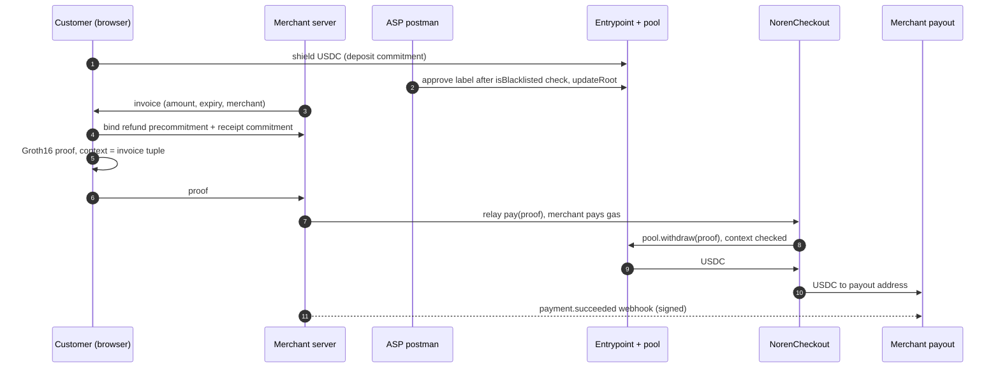
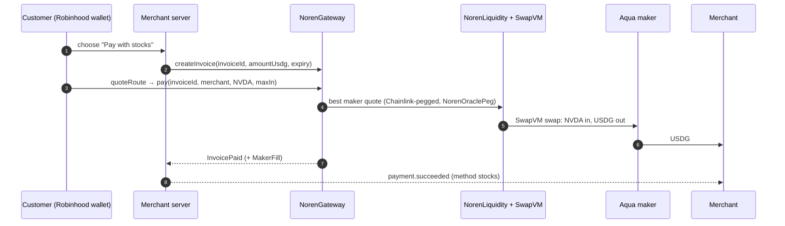
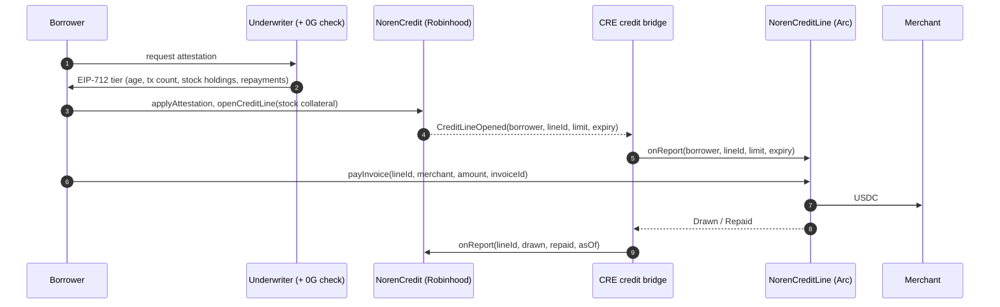

# Noren architecture


The source of the picture is [img/architecture.mmd](img/architecture.mmd). To render it again:

```sh
npx -p @mermaid-js/mermaid-cli@11.4.2 mmdc -i docs/img/architecture.mmd -o docs/img/architecture.png -b "#f4efe4" -s 2 -w 1600
```

One product, three surfaces: **Noren Merchant** (dashboard), the **Noren app** (customer) and the **Noren SDK** (`@noren/core` and the hosted checkout). Everything below runs locally with `pnpm dev:all`: an Anvil fork of Arc testnet and a warmed snapshot of Robinhood Chain mainnet state.

## The pieces

### Arc testnet (chain 5042002, gas paid in USDC)

| Component | What it does | Code |
|---|---|---|
| USDC | Circle's ERC-20 at `0x3600000000000000000000000000000000000000` (6 decimals); the same balance is the native gas token (18 decimals). On the local fork a shim stands in, because stock Anvil can't execute Arc's native USDC. | Circle |
| Entrypoint (ERC-1967 proxy) | 0xbow Privacy Pools entrypoint. Holds the ASP root; the postman role posts new roots. | `packages/contracts/lib/privacy-pools-core` (Apache-2.0) |
| PrivacyPoolComplex | The USDC pool. Deposits become commitments in a Poseidon LeanIMT; withdrawals need a Groth16 proof. | same |
| NorenCheckout | The pool's processooor for payments. The proof's context binds invoice, merchant, amount and refund precommitment, so a changed field fails (`ContextMismatch`). Pays the merchant's payout address and refunds into the customer's shielded refund inbox. Only the merchant relays its own invoices. | `packages/contracts/src/NorenCheckout.sol` |
| NorenRateOracle | Chainlink-derived FX rates written by the CRE pricing workflow; `verifyQuote` re-checks an invoice's quote at its own round IDs. | `packages/contracts/src/NorenRateOracle.sol` |
| NorenCreditLine | Receives credit limits from CRE (`onReport`, forwarder only), including the World ID starter line (report kind 2). The borrower `payInvoice`s a merchant from the USDC credit pool within the limit and `repay`s. Emits `Drawn` / `Repaid` / `CreditLineFrozen`. | `packages/arc-credit` |
| NorenQuoter | A view-only Chainlink consumer for fiat quotes, called on Arc **mainnet** (read-only). | `packages/contracts/src/NorenQuoter.sol` |

### Robinhood Chain (mainnet state, local)

| Component | What it does | Code |
|---|---|---|
| NorenCredit | Applies EIP-712 credit attestations (tiers that move with repayment history), opens collateralised credit lines for Arc (`CreditLineOpened`), takes utilisation reports from CRE, and runs **Pay in 3** plans (`INSTALLMENTS = 3`, default after two missed payments). Liquidations sell collateral to Aqua makers through SwapVM. | `packages/robinhood` |
| NorenGateway | Merchant invoices in USDG, paid with USDG, ETH or Stock Tokens. Stock and ETH payments go to the best 1inch Aqua maker; `NorenVault` is the fallback. | `packages/robinhood` |
| NorenLiquidity | The Aqua maker registry: best-quote routing for stock payments and collateral sales in liquidations. | `packages/robinhood` |
| NorenAquaSwapVMRouter + NorenOraclePeg | The official AquaSwapVMRouter (SwapVM v1.0.2) plus one instruction that prices a Stock Token from its Chainlink feed and `uiMultiplier`, against the official Aqua registry `0x1111113ccf1426a8e30e2bff5e005d929bf6a90a`. Powered by SwapVM — © Degensoft Ltd 2025. Details: [AQUA.md](AQUA.md). | `packages/aqua/swapvm-ext` (SwapVM-1.1) |
| NorenVault | ERC-4626 USDG lender pool: funds Pay in 3, holds fallback inventory, and can back an Aqua maker strategy with idle USDG. | `packages/robinhood` |
| NorenAssetOracle | Stock Token prices from Chainlink with `uiMultiplier`, staleness rules and a haircut while US markets are closed. | `packages/robinhood` |
| NorenSettlementDesk | Settle to Arc: a merchant's USDG goes to USDC on Arc through Relay or Across, approved by the CRE settlement workflow. | `packages/bridge-settlement` |
| Stock Tokens, USDG, WETH, Chainlink feeds | The real mainnet contracts and state, on a local node only. | Robinhood, Paxos, Chainlink |

### Chainlink

| Component | What it does | Code |
|---|---|---|
| Data Feeds | Arc mainnet fiat/USD and USDC/USD (read-only) for invoice quotes; Robinhood stock, ETH/USD and USDG/USD feeds for collateral and stock payments. | Chainlink |
| CRE workflow: pricing | Cron trigger: reads the Arc mainnet feeds and writes `NorenRateOracle.onReport` on Arc. | `packages/cre-pricing` |
| CRE workflow: credit bridge | Log triggers: `CreditLineOpened`/`CreditLineClosed` (Robinhood) → `NorenCreditLine.onReport` (Arc); `Drawn`/`Repaid`/`CreditLineFrozen` (Arc) → `NorenCredit.onReport` (Robinhood). HTTP trigger: World ID starter lines. | `packages/cre-bridge` |
| CRE workflow: settlement desk | Log trigger on `SettlementRequested`: compares live Relay and Across quotes with Chainlink USDG/USD and USDC/USD, then writes approve or reject. | `packages/bridge-settlement/cre` |

All three run in the CRE CLI simulator with `--broadcast` through the real MockKeystoneForwarders; nothing is deployed to a DON.

### Noren services (off-chain)

| Component | What it does | Code |
|---|---|---|
| Merchant server | Invoices, bind/pay/refund API, HMAC-signed webhooks, SSE; relays private payments and pays the gas; settles pay-later and pay-with-stocks invoices from `Drawn` and `InvoicePaid` logs; mounts World ID and Settle to Arc. | `packages/server` |
| ASP postman | Approves pool deposits only if `USDC.isBlacklisted(depositor)` is false; batches `Entrypoint.updateRoot`. | `packages/postman` |
| History underwriter | Reads a wallet's Robinhood Chain history (age, transactions, Stock Token holdings, Noren repayments) and signs the EIP-712 attestation. A wallet that locks stock always gets the collateral-only tier. | `packages/robinhood/underwriter` |
| 0G credit check | Sealed model (0GM-1.0, TeeML) on 0G Private Computer: decision, rationale, request ID and TEE verification. | `packages/ai-underwriter` |
| World ID | IDKit 4 server-signed requests, World verification, nullifier registry: one unsecured starter line per human. | `packages/world-id` |
| Web | Landing, Noren Merchant, Noren app, hosted checkout. | `packages/web` |
| SDK | `@noren/core/merchant` (`createNoren`, `verifyWebhook`) and `@noren/core/customer` (`shield`, `refundInbox`, `proveInvoicePayment`). | `packages/core` |

### Arc Studio

Arc Studio is where the Arc contracts are imported, compiled, tested and deployed for the Arc prize. See [ARC.md](ARC.md) for the Studio URL or its BLOCKED status, and [`arc-studio/`](../arc-studio) for the import script and prompt.

## Flows

### A private payment



The merchant learns that the invoice was paid in full. It never learns the payer's address, balance or history. A refund goes back through NorenCheckout into a pool commitment that only the customer's refund inbox can find.

### Pay with stocks



### Pay later: credit from Robinhood, spent on Arc



A wallet with no stock can verify with World ID instead: the merchant server sends the bridge's HTTP trigger, which opens a small unsecured starter line on Arc keyed by `NorenCreditLine.starterLineId(borrower)`.

### Fiat pricing

The merchant server reads the Arc mainnet fiat/USD and USDC/USD proxies on each quote, checks staleness, rounds up and stores both round IDs on the invoice ([CHAINLINK.md](CHAINLINK.md)). The CRE pricing workflow writes the same rates to `NorenRateOracle` on Arc, and the server records whether `verifyQuote` agrees at those rounds ("Rate verified on-chain").

### Settle to Arc

A merchant's USDG from stock payments is requested on `NorenSettlementDesk`; the CRE settlement workflow approves a route only if the live Relay or Across quote is within its band of the Chainlink fair value; a keeper then deposits on the approved route. On a local fork no relayer fills the Arc side.

## Deployment

- **Local:** `pnpm dev:all` (everything) and `pnpm dev:stack` (private payments only). `pnpm e2e` and `pnpm e2e:credit` run the flows end to end. Local runs write `deployments/5042002-fork.json` (e2e) or `deployments/31337-fork.json` (dev stack). The Robinhood snapshot and its deployment record live in `packages/robinhood/.fork/` (`sh packages/robinhood/scripts/fork-snapshot.sh`).
- **Public Arc testnet:** `pnpm deploy:arc:dry` measures the deploy on a fork from the real deployer address; `pnpm deploy:arc` writes `deployments/5042002.json`. Its status and the funding it needs are in [ARC.md](ARC.md#public-arc-testnet-deployment).
