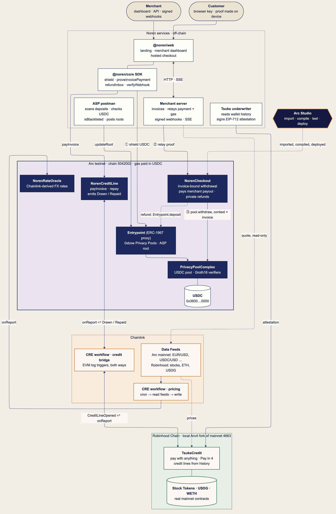
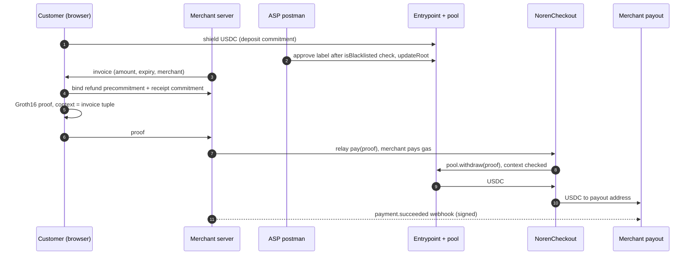
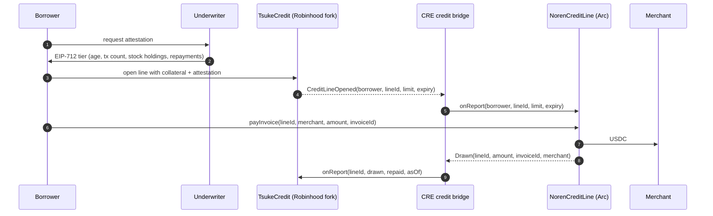

# Noren architecture



The source of the picture is [img/architecture.mmd](img/architecture.mmd). To render it again:

```sh
npx -p @mermaid-js/mermaid-cli@11.4.2 mmdc -i docs/img/architecture.mmd -o docs/img/architecture.png -b "#f4efe4" -s 2 -w 1600
```

## The pieces

**Status key**
- **main**: on `main` and covered by `pnpm e2e` on a local Arc testnet fork.
- **branch**: being built on Nov 6 on the named branch, against the interfaces in the agents' context file; not on `main` yet.

### Arc testnet (chain 5042002, gas paid in USDC)

| Component | What it does | Code | Status |
|---|---|---|---|
| USDC | Circle's ERC-20 at `0x3600000000000000000000000000000000000000` (6 decimals). The same balance is the native gas token (18 decimals). | Circle | live |
| Entrypoint (ERC-1967 proxy) | 0xbow Privacy Pools entrypoint. It holds the ASP root, and the `ASP_POSTMAN` role posts new roots. | `packages/contracts/lib/privacy-pools-core` (Apache-2.0) | main |
| PrivacyPoolComplex | The USDC pool. Deposits become commitments in a Poseidon LeanIMT, and withdrawals need a Groth16 proof (WithdrawalVerifier, CommitmentVerifier). | same | main |
| NorenCheckout | The pool's "processooor" for payments. The proof's context binds invoice, merchant, amount and refund precommitment, so a changed field fails with `ContextMismatch`. It pays the merchant's payout address and refunds into the customer's shielded refund inbox. Only the merchant can relay its own invoices. | `packages/contracts/src/NorenCheckout.sol` | main |
| NorenQuoter | A view-only Chainlink consumer that quotes fiat to USDC. It is called on Arc **mainnet** (read-only). | `packages/contracts/src/NorenQuoter.sol` | main |
| NorenCreditLine | It receives credit limits from CRE (`onReport`, forwarder only). The borrower can `payInvoice` a merchant from the Arc USDC credit pool within that limit and can `repay`. It emits `Drawn` / `Repaid`. | `packages/arc-credit` | branch `cre-bridge` |
| NorenRateOracle | Holds Chainlink-derived FX rates written by the CRE pricing workflow. | `packages/contracts/src/NorenRateOracle.sol` | branch `cre-pricing` |

### Noren services (off-chain)

| Component | What it does | Code | Status |
|---|---|---|---|
| Merchant server | Invoices, bind/pay/refund API, HMAC-signed webhooks with retries, and SSE. It relays the customer's proof to NorenCheckout and pays the gas. It reads Chainlink feeds on Arc mainnet, read-only, to quote fiat invoices. | `packages/server` | main |
| ASP postman | Scans the pool's `Deposited` logs and approves a label only if `USDC.isBlacklisted(depositor)` is false. It batches `Entrypoint.updateRoot` and serves versioned LeanIMT snapshots. | `packages/postman` | main |
| SDK | `@noren/core/customer` (`shield`, `refundInbox`, `proveInvoicePayment`) and `@noren/core/merchant` (`createNoren`, `verifyWebhook`). viem plus the Kohaku SDK. Proofs are made on the customer's device. | `packages/core` | main |
| Web | Landing page, merchant dashboard and hosted checkout. | `packages/web` | main |
| Tsuke underwriter | Reads a wallet's real Robinhood Chain history and signs an EIP-712 credit attestation. | `packages/tsuke` | branch `tsuke-credit` |

### Robinhood Chain (a local Anvil fork of mainnet 4663)

| Component | What it does | Code | Status |
|---|---|---|---|
| TsukeCredit | Pay with USDG, ETH or Stock Tokens. A USDG vault buys the asset at the Chainlink price minus a spread. Pay in 4 locks collateral, pays the merchant upfront and is repaid in 4 USDG installments. Credit tiers come from the verified attestation. It emits `CreditLineOpened` and takes utilisation reports from CRE. | `packages/tsuke` | branch `tsuke-credit` |
| Stock Tokens, USDG, WETH | The real mainnet contracts, used on the fork only, with no real money. | Robinhood | live (mainnet) |

### Chainlink

| Component | What it does | Code | Status |
|---|---|---|---|
| Data Feeds | Arc mainnet fiat/USD and USDC/USD proxies, read-only. On Robinhood mainnet: stock, ETH/USD and USDG/USD proxies. | Chainlink | live |
| CRE workflow: pricing | A cron trigger reads the feeds and writes `NorenRateOracle.onReport` on Arc. | `packages/cre-pricing` | branch `cre-pricing` |
| CRE workflow: credit bridge | A log trigger on `CreditLineOpened` (Robinhood) writes `NorenCreditLine.onReport` (Arc). A log trigger on `Drawn`/`Repaid` (Arc) writes `TsukeCredit.onReport` (Robinhood). It runs in CRE simulation; nothing is deployed to the DON. | `packages/cre-bridge` | branch `cre-bridge` |

### Arc Studio

Arc Studio is where the Arc contracts are imported, compiled, tested and deployed for the Arc prize. See [ARC.md](ARC.md) for the Studio URL or its BLOCKED status, and [`arc-studio/`](../arc-studio) for the import script and prompt.

## Flows

### A private payment (on main)



The merchant learns that the invoice was paid in full. It never learns the payer's address, balance or history. A refund goes back through NorenCheckout into a pool commitment that only the customer's refund inbox can find.

### Credit from Robinhood, spent on Arc (branches `tsuke-credit` and `cre-bridge`)



### Fiat pricing

Today (main): the merchant server reads the Arc mainnet fiat/USD and USDC/USD proxies on each quote. It checks staleness, rounds up and stores both round IDs on the invoice ([CHAINLINK.md](CHAINLINK.md)). Branch `cre-pricing` adds a CRE workflow that writes the derived rates to NorenRateOracle on Arc testnet, so they can be read on-chain on the settlement chain.

## Deployment

- **Local:** `pnpm dev:stack` and `pnpm e2e` fork Arc testnet into Anvil and deploy the real contracts. A local run writes `deployments/5042002-fork.json` (e2e) or `deployments/31337-fork.json` (dev stack).
- **Public Arc testnet:** `scripts/deploy-arc.ts`. Run `--dry-run` first: it measures the deploy on a fork from the real deployer address. The live deploy writes `deployments/5042002.json`. Its status and the funding it needs are in [ARC.md](ARC.md#public-arc-testnet-deployment).
