# Noren: product detail

The README keeps the first screen short. This page has the detail it links to: the three surfaces, the four ways to pay, how private payments and pay later work, measured numbers, screens, how to run everything, and the package map.

## One product, three surfaces

| Surface | Route | What it does |
|---|---|---|
| **Noren Merchant** | `#/dashboard` | Sign in with a wallet (SIWE), a browser wallet (EIP-6963) or Privy (email or wallet, when `VITE_PRIVY_APP_ID` is set). Payments with the method used (private pool, pay with stocks, pay later), payment links priced in 9 currencies by Chainlink, refunds, balances, webhooks, API keys, credit-line exposure, and **Settle to Arc** for USDG earned from stock payments. "Customers identified: 0" for private payments. |
| **Noren app** | `#/app` | The customer's side (a browser test key, a browser wallet, or a Privy embedded wallet), opening on **Home**: one balance (private and public USDC on Arc, USDG and Stock Tokens on Robinhood Chain at Chainlink prices, credit available), Pay (scan or paste a link, pay privately in place), Send privately, Bridge Robinhood ⇄ Arc, Earn, Credit and recent activity. Earn and Borrow show the Aqua maker behind each pool and its realised fees, and the trading fees your locked collateral earns can pay your loan down; Credit scores on-chain history (with a sealed AI second opinion on 0G), locks stock for a line and watches Chainlink CRE bridge it to Arc. No stock? World ID unlocks a small starter line. |
| **Noren SDK** | `@noren/core` | `createNoren` (invoices, refunds, webhooks, `verifyWebhook`) for merchants; `shield`, `refundInbox`, `proveInvoicePayment` for customers. The hosted checkout `#/pay/:id` is the drop-in. |

```ts
import { createNoren, verifyWebhook } from "@noren/core/merchant";
const noren = createNoren({ server, token: process.env.NOREN_SECRET_KEY, merchant });
const { invoice } = await noren.invoices.create({ amount: 7_500_000n, description: "Flat white", expiresIn: 1800 });
// send the customer to /pay/{invoice.invoiceId}; later, in your webhook handler:
const event = await verifyWebhook(rawBody, req.headers["noren-signature"], secret); // payment.succeeded → fulfil
```

## Four ways to pay one invoice

The same four in the hosted checkout, the demo shop (which sends customers to it) and the Noren app (the app pays privately in place and hands the other three to the checkout with the method chosen).

| | Pay privately | Pay with USDC | Pay with stocks | Pay in 3 / Pay later, privately |
|---|---|---|---|---|
| Customer pays with | USDC in a Kohaku privacy pool (Arc) | USDC from their Arc wallet | NVDA, TSLA, AAPL… Stock Tokens (Robinhood Chain) | A USDC credit line on Arc, backed by locked Stock Tokens |
| Merchant receives | USDC on Arc, in the payment tx | USDC on Arc | USDG on Robinhood Chain, from a 1inch Aqua maker (or Noren's vault as fallback) | USDC on Arc, upfront, from the credit pool |
| Merchant learns the payer | **no**: the proof binds the invoice, not a wallet | yes | yes (public wallet) | Pay in 3: yes. **Pay later, privately: no** (the line draws into the pool; the lender still knows the borrower) |
| Contract | `NorenCheckout` + 0xbow Privacy Pools | USDC transfer, checked by the merchant server | `NorenGateway` → `NorenLiquidity` (1inch Aqua + SwapVM), `NorenVault` fallback | `NorenCredit` (Robinhood) ↔ CRE ↔ `NorenCreditLine` (Arc) |
| Price | Chainlink fiat feeds (Arc mainnet, read-only) | same | Chainlink stock feeds (Robinhood): makers quote through the `NorenOraclePeg` SwapVM instruction; the vault adds a 0.50% spread | Chainlink stock feeds value the collateral |

Only "Pay privately" (the default) and "Pay later, privately" hide you from the merchant, and the checkout says so. **Pay from another chain** (Circle CCTP V2 with a PAY_INVOICE hook; 10 testnets configured, live from Base Sepolia) is a fifth, collapsed option; it is public on the source chain.

Pay with stocks: Powered by SwapVM — © Degensoft Ltd 2025 (see [Third-party licenses](../README.md#license-and-attributions)).

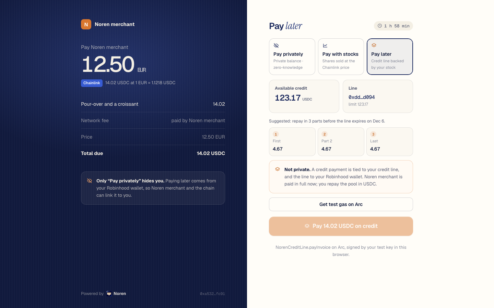

## Measured (local forks, Nov 6 2026)

| What | Result |
|---|---|
| All suites ([TESTING.md](../TESTING.md#current-totals-branch-v3-at-26892ab-nov-6-2026)) | **605 passed**, 1 skipped (weekend-only), 0 failed, 21 suites; `pnpm test` alone **142 passed**, 21 files (re-run on `26892ab`) |
| **Loans that pay themselves down** (Robinhood fork, [docs/EARN.md](EARN.md#loans-that-pay-themselves-down)) | 1 ETH + 1 NVDA locked, 500 USDG borrowed; two real Aqua fills on the vaults' asks booked 2.944337 USDG of fees; a keeper's `harvestToRepay` repaid exactly that, so the debt went from **500.000001 to 497.055664 USDG** and the principal shares stayed locked. No fills, no repayment: it depends on fills |
| `pnpm e2e`: private payment on an Arc testnet fork, real 0xbow pool and Groth16 verifier | **9/9** Foundry checkout tests, **5/5** attacks reverted on-chain (`IncorrectASPRoot`, `ContextMismatch`, `NotMerchant`, `Expired`, `AlreadyPaid`), first proof 5.03 s (cold), re-proof 1.06 s, 54.8 s total (v3 rerun, Nov 6) |
| Private payment in headless Chromium against `pnpm dev:all` | shield approved by the ASP in **6.1 s**, proof made in the browser in **1.13 s**, click to paid **6.0 s**, payer address in the tx: **none** |
| Pay from the Noren app's Home (headless Chromium, fresh wallet, `pnpm dev:all`) | open link picked → fork USDC moved into the private balance in one step → **proof 1.12 s on the device**, **tap to paid 6.2 s**, payer address in the tx: none |
| `pnpm e2e:credit`: pay with stocks + pay later, end to end | **8/8** steps in **30.9 s** (v3 stack, Nov 6): fork faucet → EIP-712 attestation verified on-chain → 2 NVDA locked → **CRE Robinhood → Arc in 7.4 s** → invoice paid later and settled by the server → 0.039935 NVDA at $188.41 pays a 7.50 invoice, filled by the **lender pool's own Aqua strategy** (fee 0.0301 USDG booked to `NorenVault`, which now shows as realised fees in Borrow) → CRE carries `Drawn` and `Repaid` back to Robinhood |
| One CRE simulator run (bridge workflow, `--broadcast` through the MockKeystoneForwarder) | 4.6–5.2 s per event |
| Settle to Arc: CRE settlement-desk workflow on a 7.50 USDG request | live quotes Relay 7.475568 / Across 7.491332 USDC against a Chainlink fair value of 7.501225; approved Across with a 7.426212 minimum in 6.4–7.1 s |
| CRE pricing workflow → `NorenRateOracle` on Arc | written in 5.0 s; a €6.90 invoice (7.740672 USDC) passes `verifyQuote` at its own Chainlink rounds |
| Browser, Noren app | fresh wallet, fork faucet, tier-1 terms (score 13/100, collateral-only floor), 1 NVDA locked → 123.80 USDC line, live on Arc after one CRE run (4.8 s), a ¥1,200 checkout (7.60 USDC via Chainlink) paid later, 1.90 USDC repaid |
| Package suites | Robinhood contracts (`NorenCredit`, `NorenGateway`, `NorenLiquidity`, `NorenVault`, `NorenBorrow`, `NorenDutch`…) **158** Foundry tests on a fresh Robinhood mainnet fork (Aqua routing, Pay in 3, Dutch-auction liquidations, self-repay); `NorenOraclePeg` + `NorenDutchDecay` + Aqua router **27** (+1 weekend-only); `NorenCreditLine` **47**; `NorenRateOracle` **22**; CRE bridge **31** + pricing **8** (bun); World ID **43** and the 0G underwriter **25** run inside `pnpm test` |

Fork transaction hashes vanish when the fork stops, so the numbers above are reproducible with the commands below rather than linked.

## Screens

| Noren Merchant | Noren app |
|---|---|
| 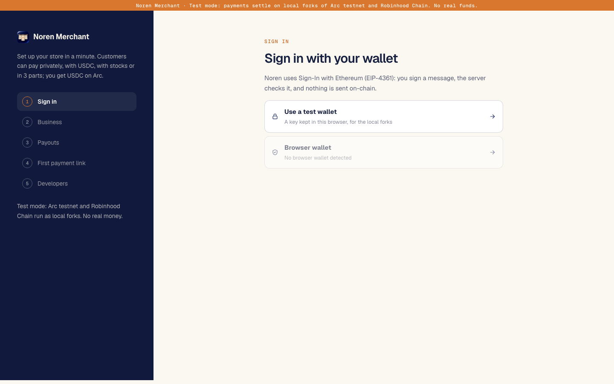 | 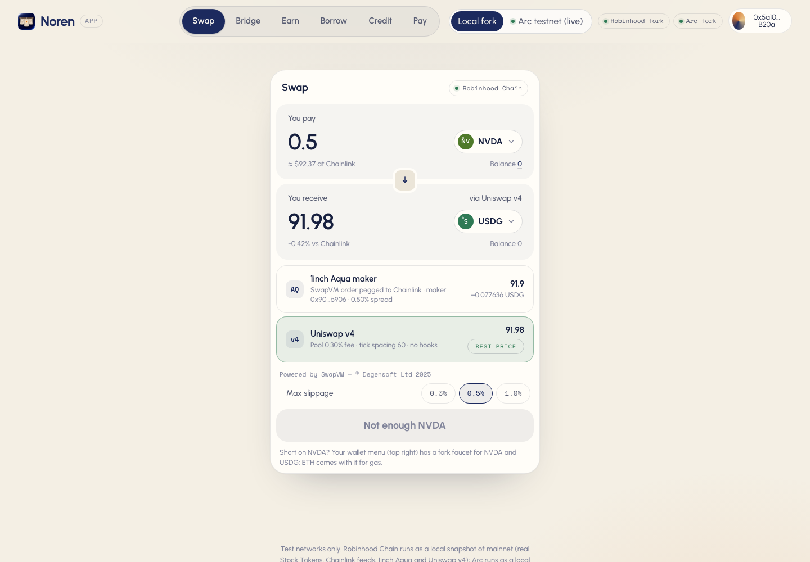 |
| 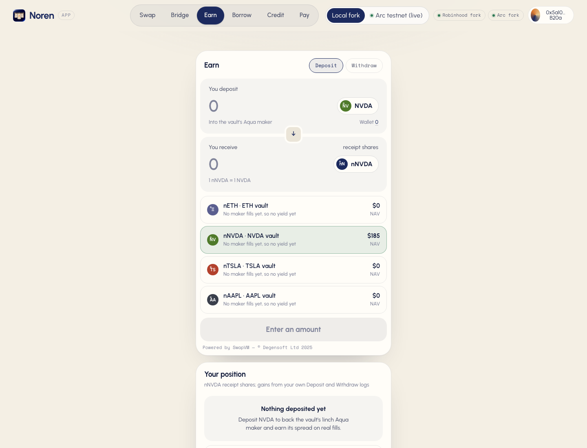 | 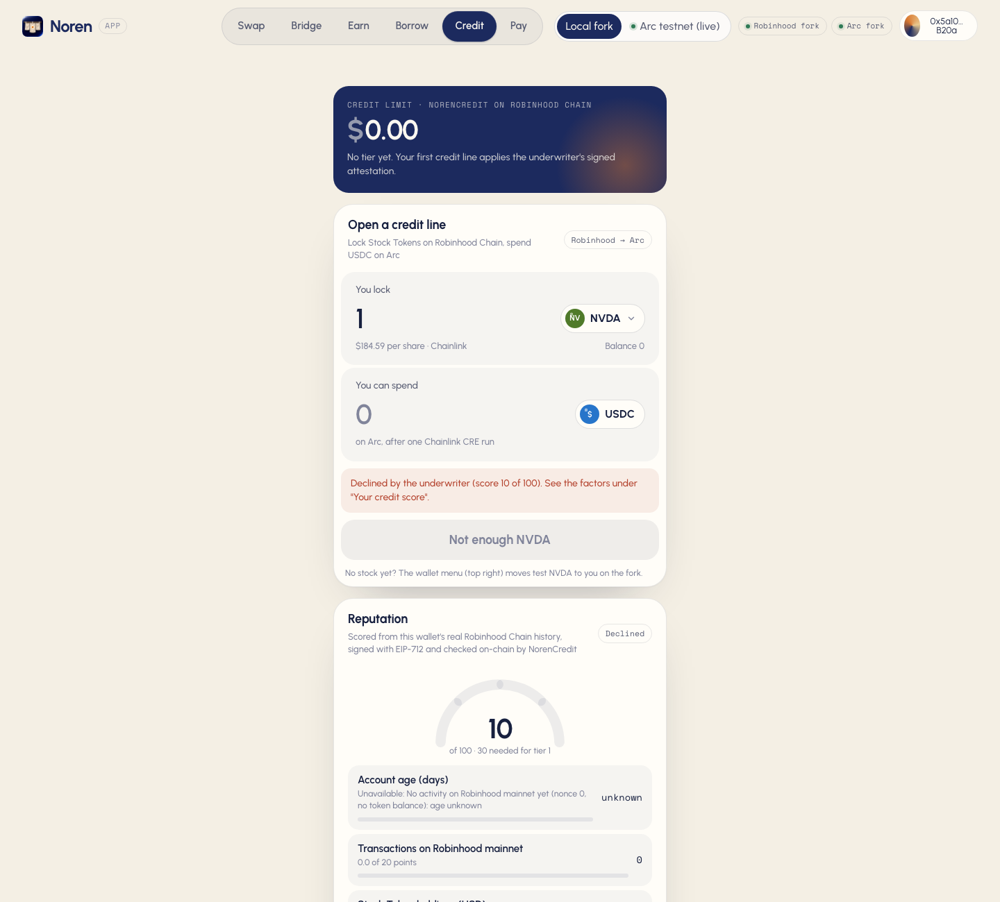 |
| 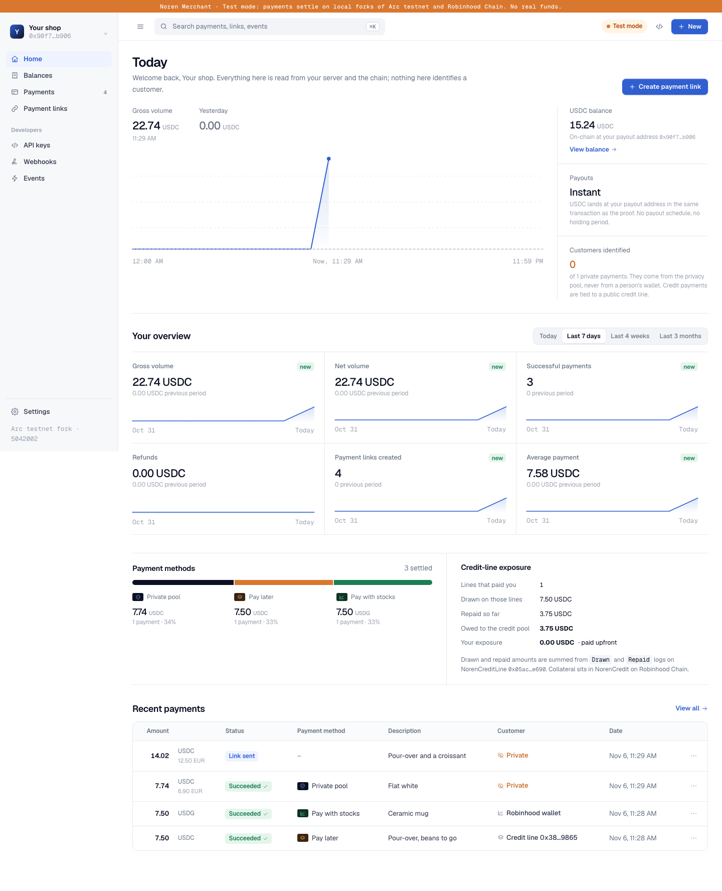 | 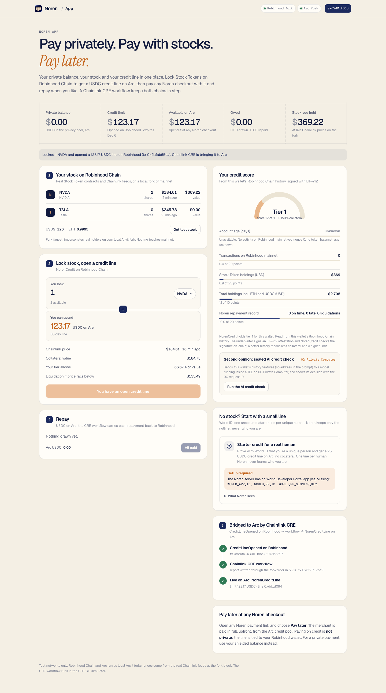 |
| 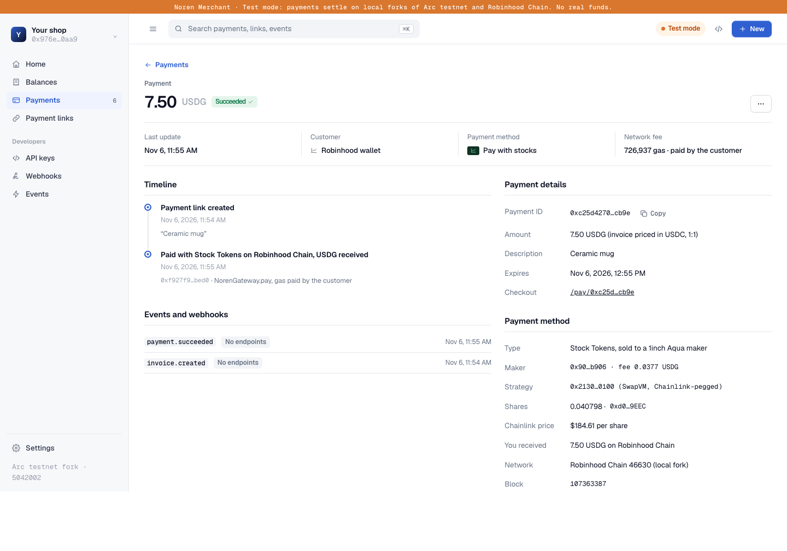 | 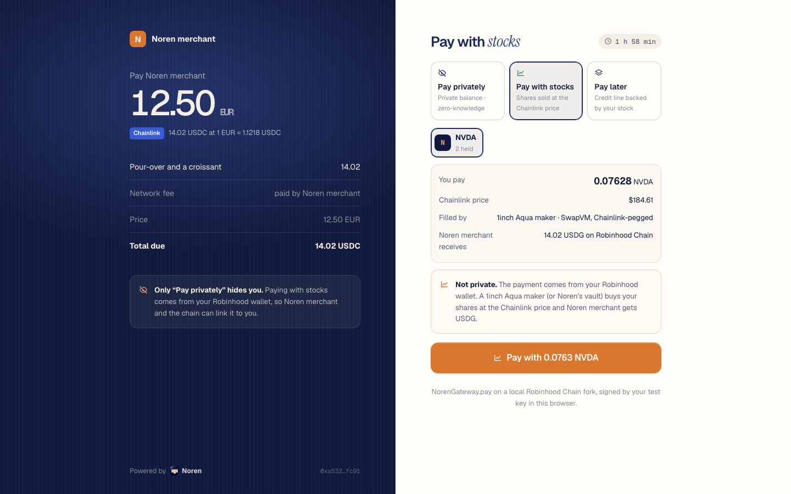 |
| 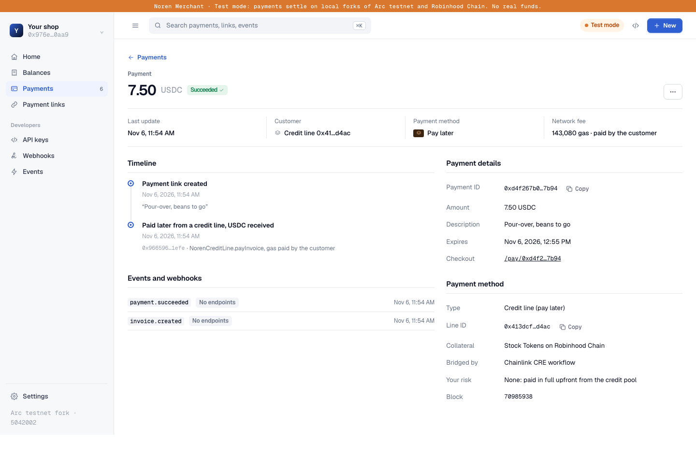 |  |
| 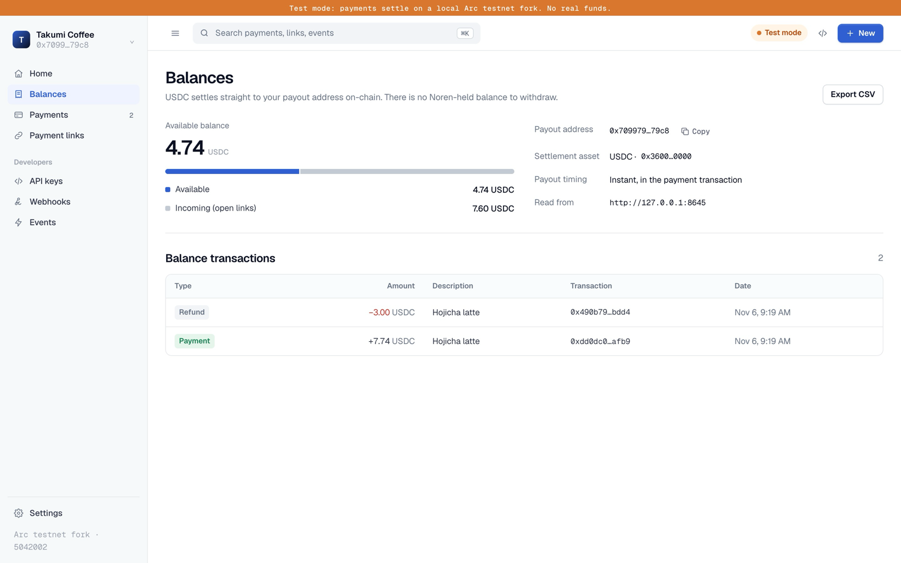 | 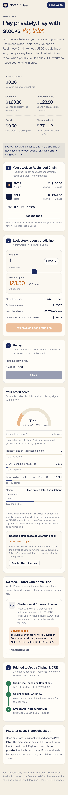 |

## Run it

```sh
pnpm install
pnpm dev:all                    # Arc fork + Robinhood snapshot + contracts + server + ASP + both CRE workflows + underwriters
pnpm --filter @noren/web dev    # http://localhost:5190  (#/dashboard, #/app, #/pay/:id)
```

`pnpm dev:all` prints the merchant secret key for Noren Merchant and a "Setup required" line for anything it can't start. In one process it runs:

- **Arc testnet fork** on :8645 with the real Privacy Pools verifiers, Entrypoint, pool, `NorenCheckout`, `NorenRateOracle` and `NorenCreditLine`. A fork-only USDC shim stands in for Arc's native USDC, which stock Anvil can't execute.
- **Robinhood Chain** on :8646, from the Robinhood package's warmed snapshot of mainnet state: the real Stock Tokens, USDG and Chainlink feeds, with `NorenCredit`, `NorenGateway` and `NorenVault` deployed. The public RPC keeps only about 10 minutes of state, so a live fork breaks; build the snapshot once with `sh packages/robinhood/scripts/fork-snapshot.sh`. The node is served as chain 46630 (Robinhood testnet's id) because that is the only Robinhood chain the CRE simulator knows, and Robinhood testnet's real `MockKeystoneForwarder` is installed on it.
- **Cross-chain Aqua** (fork): the official Aqua and SwapVM router bytecode from Arc mainnet on the Arc fork, `NorenCrossChainSettler` with an Aqua maker on Arc, `NorenCrossChainEscrow` for NVDA on Robinhood, and its CRE workflow relaying each order and fill (`GET /xchain/orders`). Skip with `NOREN_SKIP_XCHAIN=1`.
- **CRE**: the pricing workflow runs once at start (live Arc mainnet Chainlink reads, then a write to `NorenRateOracle`). The credit bridge workflow runs in the CRE simulator for every `CreditLineOpened`/`CreditLineClosed` on Robinhood and every `Drawn`/`Repaid` on Arc, with `--broadcast` through the forwarders. The run log is at `GET /credit/bridge`.
- **Merchant server** (:8790), **ASP postman** (:8788), **history underwriter** (:8791), **0G credit check** (:8792), **World ID** routes on the merchant server.

Other commands:

```sh
pnpm dev:stack       # the private-payments stack only (Arc fork)
pnpm test            # offline tests
pnpm e2e             # private payment + attacks + refund on a fresh Arc fork
pnpm e2e:credit      # pay with stocks + pay later against a running dev:all (NOREN_MERCHANT_TOKEN=<printed key>)
pnpm deploy:arc:dry  # measures the Arc testnet deploy on a fork from the real deployer; writes deployments/5042002-dryrun.json
pnpm deploy:arc      # the real Arc testnet deploy (needs NOREN_DEPLOYER_KEY and testnet USDC)
pnpm studio:import   # sends the Arc contracts to Arc Studio (needs arc-studio login)
```

Local runs write `deployments/5042002-fork.json` (e2e) and `deployments/31337-fork.json` (dev stack), never `5042002.json`.

## How a private payment works

- **Invoice-bound proofs.** The customer's Privacy Pools withdrawal proof binds the invoice, merchant, amount and refund address. Change any field and the pool rejects it (`ContextMismatch`).
- **The merchant relays.** The merchant's server submits the proof and pays about a cent of gas, so the customer needs no gas and no public wallet. Only the merchant can relay its own invoices.
- **Compliance.** The ASP postman approves a deposit only if Arc USDC's own `isBlacklisted(depositor)` is false.
- **Private refunds** go into a shielded refund inbox fixed when the customer paid. **Selective receipts** let the customer prove the purchase later, if they choose.
- **Any currency.** Links priced in EUR, GBP, JPY, CAD, AUD, MXN, BRL or KRW are quoted from Chainlink Data Feeds on Arc mainnet (read-only) and locked until expiry. Both round IDs are stored, and `NorenRateOracle` on Arc re-checks the quote at those rounds ("Rate verified on-chain").

## How pay later works

1. **Score.** The history underwriter reads the wallet's real Robinhood Chain history (account age, transaction count, Stock Token holdings at Chainlink prices, past Noren repayments) and scores it. A sealed model on **0G Private Computer** gives a second decision with a 0G request ID and TEE verification. Any wallet that locks Stock Tokens gets at least the collateral-only tier (150%); history only improves terms.
2. **Attest.** The underwriter signs an EIP-712 `CreditAttestation`; `NorenCredit.applyAttestation` verifies it on-chain.
3. **Lock.** `NorenCredit.openCreditLine` values the shares with Chainlink (with a weekend haircut when markets are closed) and emits `CreditLineOpened`.
4. **Bridge.** The Chainlink CRE workflow writes the limit to `NorenCreditLine` on Arc through the forwarder.
5. **Spend.** On any Noren checkout, "Pay in 3" calls `NorenCreditLine.payInvoice`; the merchant is paid USDC upfront and the server settles the invoice from the `Drawn` log. "Pay later, privately" calls `NorenCreditLine.drawToPool` instead: the draw becomes the customer's private balance in the Kohaku pool, and the invoice is paid from the pool ([docs/PRIVACY.md](PRIVACY.md#private-credit-pay-later-privately)).
6. **Repay.** USDC on Arc, in parts or at once; the app suggests `NorenCredit.INSTALLMENTS()` parts (3). CRE carries each `Drawn`/`Repaid` back to `NorenCredit`. Debt left after expiry plus grace, or collateral below 110% of the debt, makes the line liquidatable, and liquidation sells the collateral to 1inch Aqua makers through SwapVM.
7. **No stock?** Verify with World ID (IDKit, server-verified) for one small unsecured starter line per human. Noren stores only the nullifier.

## Repository

| Package | What |
|---|---|
| `packages/contracts` | `NorenCheckout`, `NorenQuoter`, `NorenRateOracle`, fork USDC shim; vendored Privacy Pools |
| `packages/core` | the SDK: chain config, invoice encoding, `@noren/core/merchant`, `@noren/core/customer`, Chainlink pricing |
| `packages/server` | merchant API, relay, webhooks, credit and stock settlement watchers, Robinhood fork faucet |
| `packages/postman` | ASP: USDC blacklist check, Merkle roots |
| `packages/web` | landing, Noren Merchant, Noren app, hosted checkout |
| `packages/robinhood` | `NorenCredit` (credit lines, Pay in 3), `NorenGateway`, `NorenLiquidity` (Aqua maker registry and routing), `NorenVault`, `NorenAssetOracle`, history underwriter, SDK |
| `packages/aqua` | `NorenOraclePeg` (a Chainlink-pegged SwapVM instruction) and `NorenAquaSwapVMRouter` (the official AquaSwapVMRouter plus that one opcode), under the SwapVM-1.1 license |
| `packages/arc-credit` | `NorenCreditLine` |
| `packages/bridge-settlement` | `NorenSettlementDesk`, the settlement CRE workflow and keeper (USDG → USDC on Arc via Relay or Across) |
| `packages/cre-bridge`, `packages/cre-pricing` | Chainlink CRE workflows (TypeScript) |
| `packages/cctp` | `NorenArcHook` (CCTP V2 destination caller on Arc), the CRE relay workflow, `@noren/cctp` (`bridgeToArc`, `burnFromArc`) |
| `packages/ccip` | `NorenCcipGateway`, `NorenCcipHub`, `NorenArcActionRouter` (the one router both rails land in), `NorenCcipInbox`, `@noren/ccip` |
| `packages/xchain-aqua` | cross-chain Aqua: `NorenCrossChainEscrow` (source chains), `NorenCrossChainSettler` (Arc), its CRE workflow and `@noren/xchain-aqua` |
| `film` | the demo film's edit, voice-over and recording scripts |
| `packages/ai-underwriter` | credit check on 0G Private Computer |
| `packages/world-id` | IDKit request signing, server verification, nullifier registry, `VerifyHuman` |
| `scripts` | `dev:all`, `dev:stack`, e2e runners, CRE runner, Arc deploy |
